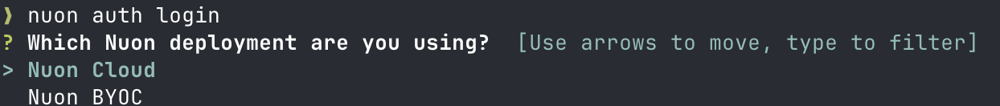
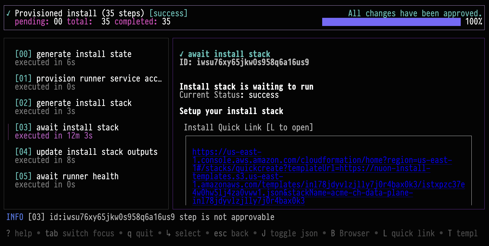
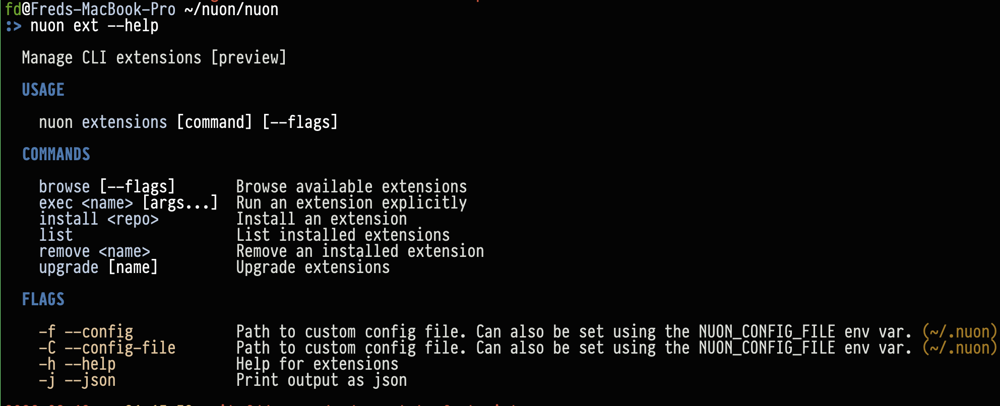

## Installation

### Homebrew

We publish an official tap you can install with [Homebrew](https://brew.sh/).

```sh
brew install nuonco/tap/nuon
```

This installs the latest release. If your control plane runs an older version, as Nuon BYOC and Self-Hosted control
planes often do, install that version instead. See [Choosing a CLI version](#choosing-a-cli-version).

After installation, you may need to refresh your shell session, for example with `source ~/.zshrc` or
`source ~/.bashrc`.

You can also enable autocomplete for you shell. Run `nuon completion` to see what shells we support.

```sh
source <(nuon completion <your-shell>)
```

### Install Script

If you are not using Homebrew, you can use our install script to automatically download and install the correct binary
for your platform (macOS or Linux). It requires `curl` and `jq`.

```sh
bash <(curl -sSL https://nuon-artifacts.s3.us-west-2.amazonaws.com/cli/install.sh)
```

The script detects your OS and architecture, installs the latest release of `nuon` and the `nuon-lsp` language server
into `~/bin` (or `/usr/local/bin` if `~/bin` does not exist), and checks that the `nuon` on your `PATH` is the version
it installed.

To install a specific release, set `NUON_VERSION`. Pass `--no-input` to skip the confirmation prompt, for example in CI:

```sh
NUON_VERSION=0.19.1260 bash <(curl -sSL https://nuon-artifacts.s3.us-west-2.amazonaws.com/cli/install.sh) --no-input
```

### Manual Binary Download

You can also download binaries directly for macOS or Linux:

- `darwin_amd64`
- `darwin_arm64`
- `linux_arm`
- `linux_arm64`
- `linux_386`
- `linux_amd64`

Binaries are published to `https://nuon-artifacts.s3.us-west-2.amazonaws.com/cli/$VERSION/nuon_$PLATFORM`, with a
gzipped copy at the same URL plus `.gz`. The latest release number is published at
`https://nuon-artifacts.s3.us-west-2.amazonaws.com/cli/latest.txt`. To pick the right version, see
[Choosing a CLI version](#choosing-a-cli-version).

An example of downloading version `0.19.1260` of the CLI for `darwin_arm64`:

```sh
curl -fsSL -o nuon https://nuon-artifacts.s3.us-west-2.amazonaws.com/cli/0.19.1260/nuon_darwin_arm64
```

Once the binary has been downloaded, make it executable and move it into a directory on your `PATH`.

```sh
chmod +x nuon
```

### Debug Mode

In the case that something goes wrong, you can set the environment variable `NUON_DEBUG` to print verbose logs. These
can be helpful to share with us, while debugging any issues.

```sh
NUON_DEBUG=true nuon apps list
```

## Choosing a CLI version

The CLI and the control plane are released together and share a version number. Install the CLI version that matches
your control plane.

| Deployment                                    | CLI version to install       | When to update                                     |
| --------------------------------------------- | ---------------------------- | -------------------------------------------------- |
| [Nuon Cloud](/guides/nuon-cloud)              | The latest release           | After each Nuon release. Nuon Cloud upgrades with every release. |
| [Nuon BYOC](/guides/byoc)                     | Your control plane's version | After Nuon upgrades your control plane.            |
| [Nuon Self-Hosted](/guides/self-hosted)       | Your control plane's version | After you upgrade your control plane.              |

### Check your versions

`nuon version` prints the CLI's version, your control plane's version, and the minimum CLI version your control plane
requires, if it sets one:

```sh
nuon version
```

If the CLI isn't pointed at a control plane yet, or can't reach it, `nuon version` prints only the CLI's version.

To look up the control plane's version without the CLI, for example in a script, query its `/version` endpoint. This
uses Nuon Cloud unless `NUON_API_URL` is set:

```sh
curl -s "${NUON_API_URL:-https://api.nuon.co}/version" | jq -r .version
```

### Update to the latest release

On Nuon Cloud, update with Homebrew:

```sh
brew update
brew upgrade nuonco/tap/nuon
```

If you installed with the install script, run it again. For manual installs, download the version in `latest.txt`.

### Install your control plane's version

On Nuon BYOC or Self-Hosted, install the version your control plane reports. With the install script, you can look up
the version and install it in one step:

```sh
export NUON_API_URL=https://api.your-byoc-instance.com

NUON_VERSION=$(curl -fsS "$NUON_API_URL/version" | jq -r .version) \
  bash <(curl -sSL https://nuon-artifacts.s3.us-west-2.amazonaws.com/cli/install.sh) --no-input
```

With Homebrew, every release is published as a versioned formula, `nuonco/tap/nuon@<version>`. To install one, or to
keep several versions and switch between them, see [Using multiple CLI versions](/guides/cli-versions).

For a manual install, download the binary for your control plane's version as shown in
[Manual Binary Download](#manual-binary-download).

In GitHub Actions, the [Nuon GitHub Action](/guides/github-actions#choosing-the-cli-version) installs your control
plane's version by default.

### Version warnings

The control plane publishes two CLI floors on `GET /v1/general/cli-config`.

`min_cli_version_policy.error` is the oldest CLI that control plane will run. Commands other than `version`, `help`,
`docs`, and `login` stop when your CLI is older than that floor. `login` still signs you in and prints the message.

`min_cli_version_policy.warn`, when set, prints a warning and the command still runs. An empty warn means the CLI does
not warn. Nuon Cloud leaves warn empty so a routine promote does not nag. Nuon BYOC and Self-Hosted set warn when they
want an upgrade nudge.

`min_cli_version` is deprecated. It remains the warning floor for older CLIs, and is used only when
`min_cli_version_warn` is empty. Set `min_cli_version_warn` to a version, or to `latest`, to follow Nuon's latest
release. The control plane resolves `latest`. `min_cli_version_error` is a pinned version.
`server_side_sync_min_cli_version` stays a separate warning on `nuon apps sync` for CLIs that predate server-side app
config sync.

When you see a warning or an error, update the CLI. On Nuon Cloud,
[update to the latest release](#update-to-the-latest-release). On Nuon BYOC or Self-Hosted,
[install your control plane's version](#install-your-control-planes-version).

### Using the CLI with Nuon BYOC or Self-Hosted

If you use [Nuon BYOC](/guides/byoc) or [Nuon Self-Hosted](/guides/self-hosted), your control plane runs in your own
infrastructure, and the CLI needs its API URL. By default, the CLI uses Nuon Cloud (`https://api.nuon.co`).

`nuon auth login` asks which deployment you use. Choose Nuon BYOC and enter your control plane's API URL:



Or set the API URL with `NUON_API_URL`, and login asks you to confirm it instead:

```sh
NUON_API_URL=https://api.acme-byoc.example.com nuon auth login
```

Login saves the API URL, your token, and your selected org to the CLI's config file, `~/.nuon`, so later commands use the
same control plane. Logging in to another control plane replaces them. If you also use Nuon Cloud or another control
plane, give each one its own config file with `NUON_CONFIG_FILE` (or `--config`):

```sh
NUON_CONFIG_FILE=~/.nuon-acme-byoc NUON_API_URL=https://api.acme-byoc.example.com nuon auth login
NUON_CONFIG_FILE=~/.nuon-acme-byoc nuon apps list
```

A shell alias saves typing the config file each time:

```sh
alias nuon-byoc='NUON_CONFIG_FILE=~/.nuon-acme-byoc nuon'
nuon-byoc apps list
```

Then [install your control plane's version](#install-your-control-planes-version) of the CLI. To keep it alongside the
latest release for Nuon Cloud, and point an alias at each, see [Using multiple CLI versions](/guides/cli-versions).

## Nuon Preview Features

We are working on a number of TUIs for the CLI. These include contextual TUIs for object selection and full-page TUIs
for workflows and actions. These features can be enabled by setting `NUON_PREVIEW=true`.



At the time of writing, we have experimental TUIs for actions, workflows, and for creating new installs.

### Nuon CLI Extensions

The `nuon` cli has support for extensions. You can browse nuon-authored extensions with `nuon ext browse` and author
your own. At the time of writing, we have published a handful of extensions for public consumption. Try our api
extension with `nuon install api`.


