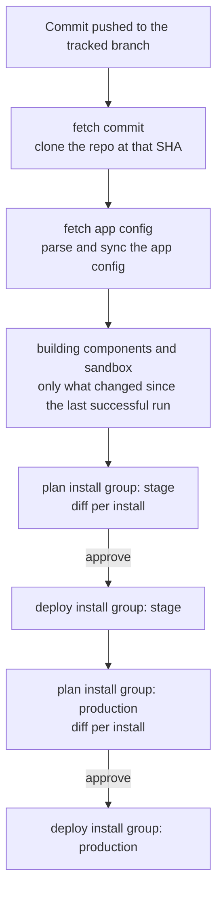

import { TryWithYourAgent } from "/snippets/try-with-your-agent.jsx";

## What is an App Branch?

An app branch connects one git branch to your [app template](/concepts/apps). By default, a push to the tracked branch triggers
Nuon to fetch the config at that commit, build whatever changed, and roll the new version out across your customer
[installs](/concepts/installs) in an order you define, with a plan and approval gate for each install group.

You can also start runs with a matching tag, an exact label on a merged pull request, or a manual trigger from the CLI,
API, or dashboard. Opening or updating a pull request can start a preview, which reports changes without rolling out
the fleet.

Before app branches, updating a fleet meant syncing config from your laptop and driving each install yourself. An app
branch makes the git event the trigger, and makes the rollout a single reviewable workflow.

## The end-to-end flow



Each box is a step in a single workflow, visible in the dashboard and in the CLI workflow TUI. The step names above
are the real ones you will see. Two of them behave specially:

- **`plan install group: <name>`** is an approval step. It computes the config diff for every install in the install
  group and then waits. Nothing is applied to those installs until a human approves it in the dashboard, or an API
  caller advances it.
- **`plan install group: <name>`** and **`deploy install group: <name>`** are skippable, so you can let a rollout
  move past an install group without deploying to it.

<Note>
  **`building components and sandbox`** builds your components on every run, and builds the sandbox into an artifact
  when the app has a sandbox config. See [sandbox builds](/guides/sandbox-builds).
</Note>

Install groups run in the order you declare, and the approval in front of each install group is what makes the
rollout staged: the second install group does not start until you approve the first.

## Structuring branches and install groups

An **app branch** is a release train: which git ref you watch, and how installs on that train are rolled out. An
**install group** (`install_groups` in TOML) is a wave inside that train. It is the unit of order and approval.
Install groups pick installs with a `label_selector`. Labels live on [install configs](/guides/install-configs); you
apply them with `nuon installs sync`.

Common layouts:

- **Snowflake customers:** one app branch per customer (their own cadence and approvals). Install groups on that
  branch for `stage` → `production`.
- **Homogeneous fleet:** one app branch for many installs that share the same app config (for example single-tenant
  customers in the vendor's cloud). Install groups for stage, then production across the fleet.
- **Cadence cohorts:** more than one branch of the same app, such as `main` on every push for early customers and a
  slower branch (`on_tag`, `on_github_label`, or `manual_only`) for weekly or monthly updates.

Whenever you declare install groups, **exactly one** install group must set `default = true`. That install group
catches installs on the branch that match no other selector. An install belongs to **one** app branch at a time. See
the [guide](/guides/app-branches#structure-branches-and-install-groups) for sketches of each pattern.

## What triggers an app branch run

A **branch run** is the workflow Nuon starts for a change: it fetches the config at a git commit, builds what
changed, then plans and deploys through your install groups (with a plan and approval at each step).

Previews are optional but recommended for testing a change before it merges into the tracked branch. A preview run
starts only from a pull request into the tracked branch (automatic `[preview]` defaults) or manually from the CLI
or dashboard (`nuon branches preview`). It never rolls install groups. Fleet runs (push, tag, label,
`nuon branches trigger`) are separate and do not use `[preview]`. A preview can stop at build, build and plan, or
build, plan, and apply to a preview install. See [Previews](/guides/app-branches#previews).

| Trigger (dashboard / CLI) | What starts it | Branch config |
| --- | --- | --- |
| **Commit pushed** | Push to the tracked branch (fleet run) | `[run] mode = "push"` (default) |
| **Pull request** | PR opened or updated against the tracked branch (**preview** only; no install groups) | `[preview]` settings (GitHub App for comments and statuses) |
| **Manual run** | `nuon branches trigger`, API, or dashboard (fleet run) | Always available |
| **Tag pushed** | Tag matching `tag_prefix` on that branch's history (fleet run) | `[run] mode = "on_tag"` |
| **Label triggered** | Merged PR with an exact label (fleet run) | `[run] mode = "on_github_label"` |

`[run] mode = "manual_only"` turns off automatic Commit pushed / tag / label starts; you still trigger runs by hand.

## Install groups

An install group is a named subset of your installs that receives an update as a unit. Install groups are the unit of
ordering and the unit of approval. Names are yours; common examples are `stage`, `production`, `uat`, `canary`, and
`preview`.

You declare them on the branch config as `[[install_groups]]`. Each install group picks installs with a
`label_selector` (all listed labels must match). Prefer keeping those labels in install config files and applying them
with `nuon installs sync`.

```toml branches/main.toml
name = "main"

[connected_repo]
repo      = "acmeco/my-app-config"
directory = "."
branch    = "main"

[[install_groups]]
name  = "stage"
order = 1
[install_groups.label_selector]
env = "stage"

[[install_groups]]
name    = "production"
order   = 2
default = true
[install_groups.label_selector]
env = "prod"
```

`order` controls which install group deploys first: lower runs first. **Exactly one** install group must set
`default = true` when you declare any install groups.

## Plans, diffs, and approvals

Every change a branch run applies to an install is planned and reviewed first. Each `plan install group` step
computes a diff per install in that install group. By default the plan waits for approval. Set
`auto_approve_on_policies_passing = true` on an install group to approve automatically when policy checks pass.

<TryWithYourAgent
  title="Approve a rollout"
  tools={["list_app_branches", "get_app_branch_run", "get_approval_plan_diff", "approve_step"]}
  writes
  prompt={`Show me the latest run of my Nuon app branch, summarize each install group's plan, and approve it if I agree.`}
/>

## Install version history

Every config change to an install is recorded as an *app config version*. On the install, browse them under
**Configuration → App branch → Applied config history**, or over the API; there is no dedicated CLI command. Each
version includes the component diff for that change, not a picker between arbitrary versions.

Because any past version can be applied again, the history doubles as a recovery path. The
[rollback guide](/guides/rollback-install-config) walks through the exact calls.

## Notifications and automation

Branch runs emit the same signals as the rest of the platform, so you can watch them without polling:

- **[Slack](/guides/slack):** branch run notifications follow your org's existing Slack preferences.
- **[Webhooks](/guides/webhooks):** branch runs emit workflow and workflow step lifecycle events
  (`com.nuon.workflow.lifecycle.v1`) with `data.workflow.owner_type` of `app_branches`, plus an event when an app
  config is synced. External systems can react to a plan being ready, or to an install group finishing, and can drive
  the next approval through the API.

## Rules and limits

Know these constraints before you design your branch layout:

- All branches of one app must point at the **same repository**. The branch and directory within it may differ.
- An install can belong to **one app branch** at a time.
- Two branches of the same app cannot use an **identical label selector**.
- When `install_groups` is non-empty, **exactly one** install group must set `default = true`.
- Every qualifying event on the tracked branch can start a run. Scope what a branch watches with `directory` on the
  repo block and, when several apps share a repo, `ignore_changes_regex`.

## Migrating to app branches

If you’re moving off CLI-driven `nuon apps sync`, see the [App branch migration](/guides/app-branch-migration) guide.

## Next steps

<CardGroup cols={2}>
  <Card title="Configure app branches" icon="screwdriver-wrench" href="/guides/app-branches">
    Write a branch config, structure install groups, sync with `nuon branches sync`, and optionally set up previews.
  </Card>
  <Card title="Walkthrough" icon="rocket" href="/get-started/app-branches-walkthrough">
    Add an app branch to the `eks-simple` example app template end to end.
  </Card>
  <Card title="Branch config reference" icon="file" href="/config-ref/branch">
    Every field in a branch file.
  </Card>
  <Card title="Workflows" icon="circle-nodes" href="/concepts/workflows">
    How plans, approvals, and diffs work for an individual install.
  </Card>
</CardGroup>
