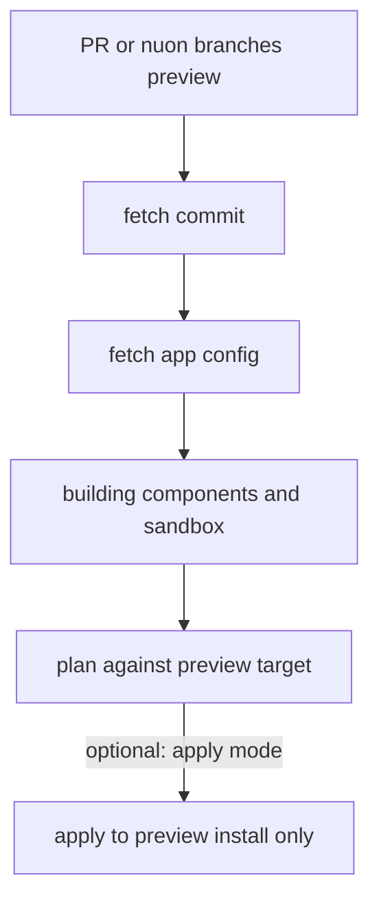

This guide walks through setting up an [app branch](/concepts/app-branches) on an existing app template: writing the branch
config, choosing how to structure branches and install groups, syncing settings into Nuon, triggering runs, and
approving them.

## Prerequisites

- An [app template](/concepts/apps) already in Nuon, with at least one install.
- The [Nuon CLI](/cli) installed and authenticated (`nuon auth login`).
- For pull request previews, the **Nuon GitHub App connected in your org for the repository's owner**. See
  [connecting a repository](/guides/vcs).

## Write a branch config

Add a `branch.toml` at the root of your app config directory (next to `metadata.toml`), **or** put one file per branch
under `branches/` (for example `branches/main.toml`). You cannot use both layouts in the same app directory.

```toml branches/main.toml
name = "main"

[connected_repo]
repo      = "acmeco/my-app-config"
directory = "."
branch    = "main"

[run]
mode = "push"

[[install_groups]]
name  = "stage"
order = 1
[install_groups.label_selector]
env = "stage"

[[install_groups]]
name    = "production"
order   = 2
default = true
[install_groups.label_selector]
env = "prod"
```

### Key fields

- **The repo block.** Use `[connected_repo]` for a repository connected through the Nuon GitHub App, or
  `[public_repo]` for a public one. Exactly one of the two. `repo` is typically `owner/name` (for example
  `acmeco/my-app-config`). `directory` is the path to your app config within the repo, or `"."` at the root.
- **`name`** is the branch's name in Nuon (from this key, not the filename). Pass it to `nuon branches trigger` and
  related commands.
- **Install group order and default.** Lower `order` deploys first. When you declare any `install_groups`,
  **exactly one** install group must set `default = true` (usually your catch-all / production wave). Sync fails if
  none or more than one is default.
- **`[preview]` (optional but recommended).** Defaults for preview runs only (pull request or manual CLI/dashboard).
  Use them to test a change before it merges into the tracked branch. Not used by fleet runs. See
  [Previews](#previews).

Full field list: [branch config reference](/config-ref/branch).

### Control when the branch runs

Omit `[run]` (or set `mode = "push"`) to run on every qualifying push to the tracked branch. Other modes:

```toml
[run]
mode       = "on_tag"
tag_prefix = "foobar/"
```

`on_tag` starts a run when a tag matching `tag_prefix` lands on that branch's history.

```toml
[run]
mode         = "on_github_label"
github_label = "deploy-cadence-daily"
```

`on_github_label` starts a run when a merged pull request carries that exact label. It requires `[connected_repo]`.
Use `manual_only` when nothing automatic should start a fleet run. Manual triggers (`nuon branches trigger`,
dashboard) remain available in every mode.

Full trigger table: [What triggers an app branch run](/concepts/app-branches#what-triggers-an-app-branch-run).

### One branch file or several

Use either a root `branch.toml` or `branches/*.toml`, not both. The `name` key inside each file is the Nuon app
branch name, not the filename.

Use `branches/` when the app has more than one app branch (for example one per snowflake customer, or cadence
cohorts). Which pattern to pick is under [Structure branches and install groups](#structure-branches-and-install-groups)
and in [concepts](/concepts/app-branches#structuring-branches-and-install-groups).

## Structure branches and install groups

Pick a layout that matches how your customers take updates. Labels on **install configs** are what install groups
select; branch files only declare the selectors. Install group names are yours (for example `stage`, `production`,
`uat`, `canary`, `preview`); sketches below use `stage` then `production`.

### Snowflake customers

Use one app branch per customer to give each its own approvals and cadence. Install groups on that branch define
environment waves:

```toml branches/acme.toml
name = "acme"

[connected_repo]
repo      = "acmeco/my-app-config"
directory = "."
branch    = "main"

[[install_groups]]
name  = "stage"
order = 1
[install_groups.label_selector]
customer = "acme"
env      = "stage"

[[install_groups]]
name    = "production"
order   = 2
default = true
[install_groups.label_selector]
customer = "acme"
env      = "prod"
```

Each customer's installs carry `customer` + `env` labels in their install TOMLs.

### Homogeneous fleet

One app branch, many installs that share the same app config (for example single-tenant customers in the vendor's
cloud). Install groups are environment waves across the fleet:

```toml
[[install_groups]]
name  = "stage"
order = 1
[install_groups.label_selector]
env = "stage"

[[install_groups]]
name    = "production"
order   = 2
default = true
[install_groups.label_selector]
env = "prod"
```

### Cadence cohorts

Two (or more) branches of the **same** app and repo: fast customers on every push, slower customers on a gated mode.

- `branches/main.toml`: `[run] mode = "push"`, with install groups for installs labeled `cadence = "continuous"`.
- `branches/monthly.toml`: `[run] mode = "on_tag"` (or `on_github_label` / `manual_only`), install groups for
  `cadence = "monthly"`.

Remember: two branches of one app cannot share an identical `label_selector`, and an install can sit on only one
branch.

## Sync the branch config

Use **`nuon branches sync`** to reconcile branch settings into Nuon. Do not use `nuon apps sync` for branch settings:

```sh
nuon apps select
nuon branches sync --file branch.toml --confirm
# or, for a directory of branch files:
nuon branches sync --file branches/ --confirm
```

This creates or updates the branch in Nuon: install groups, and any `[run]` / `[preview]` you set. The first sync for
a branch (with a connected or public repo) also starts an app branch run that fetches the tracked ref, syncs the app
config, and builds OCI artifacts for components and the sandbox (when configured). With no installs on the branch
yet, that run stops after the build. Later syncs update branch settings; shipping config to installs is a
[branch run](#trigger-a-run) from a push, tag, label, or `nuon branches trigger`.

Confirm:

```sh
nuon branches list
nuon branches get --branch-id main
```

## Label your installs

Pin each install to a branch with `app_branch`, and set the labels install groups select. Prefer install config
files:

```toml installs/customer-acme.toml
name       = "customer-acme"
app_branch = "main"

[labels]
env = "prod"
```

Changing `app_branch` moves the install and applies the branch's latest non-preview run. Omitting it leaves the
install's current branch unchanged.

Apply them:

```sh
nuon installs sync -d installs/ --app-id <your-app-id> --confirm
```

Or set labels imperatively:

```sh
nuon installs labels set --install-id customer-acme env=prod
nuon installs labels list --install-id customer-acme
nuon installs list --labels env=prod --limit 200
```

All labels passed to `--labels` must match (same AND semantics as an install group's `label_selector`).

## Trigger a run

Once the branch exists, a qualifying **Commit pushed** to the tracked branch starts a run that fetches that commit's
app config, runs **`building components and sandbox`**, then plans and deploys each install group:

```sh
git commit -am "bump chart version"
git push origin main
```

You can also start a run without waiting for a push:

```sh
# Runs against the tracked branch's latest commit.
nuon branches trigger --branch-id main

# Rebuild every component instead of only what changed.
nuon branches trigger --branch-id main --force

# Deploy a specific git source (PR number, tag name, or commit SHA).
nuon branches trigger --branch-id main --run-type commit --run-ref abc1234
nuon branches trigger --branch-id main --run-type tag --run-ref v1.2.3
nuon branches trigger --branch-id main --run-type pr --run-ref 42
```

By default the trigger uses the tracked branch's latest commit. With `--run-type` (`pr`, `tag`, or `commit`) and a
matching `--run-ref`, it deploys that source instead. To test a committed ref without starting a fleet run, use
`nuon branches preview` as described in [Previews](#previews). The CLI does not send uncommitted local files to an app
branch run.

Watch runs with `nuon branches runs --branch-id main` (workflow TUI) or in the dashboard **Branches** view. See the
[TUI reference](/tui).

### What a run rebuilds

A run compares each component's configuration and Git source with its previous successful build. For Git-backed
components and sandboxes, the source boundary is the configured `public_repo.directory` or `connected_repo.directory`.
Nuon resolves the tracked ref to a commit and compares that directory's Git tree ID, without cloning the repository
to decide whether a build is needed.

| What changed | What rebuilds it |
| --- | --- |
| A component's TOML configuration, or referenced configuration contents such as Helm values | The next branch run |
| Files inside a component or sandbox's source directory, in the app repo or another configured Git repo | The next branch run |
| Files elsewhere in the repository, including sibling dependencies and symlink targets outside the source directory | No automatic rebuild; use a forced rebuild |
| Remote dependencies whose declarations inside the source directory did not change | A forced rebuild |

<Tip>
When a component's source lives in your app repository, set its `branch` to the branch your
[branch file](#write-a-branch-config) tracks. Each branch run then builds the component from that run's commit. With a
different `branch`, the component builds from the latest commit on that branch instead.
</Tip>

Keep build inputs within the selected source directory for automatic change detection. Nuon does not discover or
watch sibling dependencies. Choosing `directory = "."` tracks the whole repository, but that directory must also be
a valid build root: for example, the Helm chart or Terraform module must live there. Changes in a different source
repository are checked when a branch run starts; they do not independently trigger an app branch run.

Build reuse requires verified source evidence from a successful build. Older builds without that evidence may need
one rebuild before they can be reused. Non-Git sources, such as container images and Helm repositories, use their
own source-resolution rules.

<CodeGroup>
```toml branches/main.toml
[connected_repo]
repo      = "acmeco/my-app"
directory = "."
branch    = "main"
```

```toml components/api.toml
[connected_repo]
repo      = "acmeco/my-app"
directory = "api"
branch    = "main"   # same branch as branches/main.toml
```
</CodeGroup>

## Approve or skip an install group

A run pauses at each install group's plan step until someone acts on it. In the dashboard, open the app's
**Branches** view, then the run, and you will see the **Deployment plan** with each install group's steps.

For each install group:

- **Approve install group plan:** read the per-install diff, then approve to let the install group's deploy step run.
- **Skip install group:** move the rollout past this install group's deploy without applying it.

The run stops at the next install group's plan step, so each install group is approved or skipped on its own. By
default the plan waits for approval. Set `auto_approve_on_policies_passing = true` on an install group to approve
automatically when policy checks pass. You can also subscribe to [webhook](/guides/webhooks) events and approve
through the API.

## Previews

Previews are optional but recommended for testing a change before it merges into the tracked branch. A branch can
roll out from push, tag, label, or manual trigger with no `[preview]` block. `[preview]` sets defaults for
**preview runs** only.

A preview never rolls install groups. It shares the early steps of a fleet run (fetch, sync config, build), then plans
or applies against a single **preview target install** only:



`build-only` stops after build, `plan-only` after plan, and `apply` continues to the preview install. Fleet runs
(push, tag, label, `nuon branches trigger`) are separate and do not run `[preview]`.

A preview run starts in one of two ways:

| How it starts | What happens |
| --- | --- |
| **Pull request** | Open or update a PR into the tracked branch (head is usually your feature branch). Uses `[preview]` defaults. Comments and statuses need the GitHub App. |
| **Manual** | CLI or dashboard (`nuon branches preview`) against a committed ref or PR number — including a branch that is not the tracked branch. |

For most preview modes you need a **`[preview]` block** that sets depth and (when required) the target install. See
[connecting a repository](/guides/vcs) for the GitHub App.

### Modes

| Mode | What it does |
| --- | --- |
| `build-only` | Build and validate. No install target. |
| `plan-only` | Build and plan against the preview target. Default when the block is present and mode is omitted. |
| `apply` | Build, plan, and apply to the preview target install only. |
| `none` | Turn automatic PR previews off. |

### `[preview]` fields

| Field | Purpose |
| --- | --- |
| `mode` | `none`, `plan-only`, `apply`, or `build-only` |
| `label_selector` | Labels that select the preview install (preferred) |
| `install_name` | Preview install by name (resolved at sync) |
| `install_id` | Preview install by ID |
| `set_statuses` | Post GitHub commit statuses for preview runs (default true) |
| `comment` | Comment on the pull request with preview results (default true) |
| `ignore_drafts` | Skip draft PRs until ready for review (default true) |
| `react` | Add a GitHub eyes reaction when a preview starts (default true) |

Use **one** of `label_selector`, `install_name`, or `install_id`. For `plan-only` and `apply`, a target is required.
`build-only` and `mode = "none"` do not take a target install.

```toml
[preview]
mode         = "plan-only"
set_statuses = true
comment      = true
ignore_drafts = true
react        = true

[preview.label_selector]
preview = "true"
```

Create a dedicated preview install and sync it before you rely on `apply`.

### Start a preview

**Manual** (CLI or dashboard), with an optional `--mode`:

```sh
nuon branches preview --branch-id main --git-ref my-feature --mode plan-only
nuon branches preview --branch-id main --git-ref my-feature --mode apply
nuon branches preview --branch-id main --git-ref my-feature --mode build-only
```

**Pull request:** open or update a PR into the tracked branch (starts automatically from `[preview]`), or preview by
number:

```sh
nuon branches preview --branch-id main --pr-number 123
```

After you connect the GitHub App once for an owner, every branch tracking a repo under that owner can post PR
feedback. A `[public_repo]` branch is fine if the owner is connected.

## Multiple apps in one repository

In a repository with several app configs (for example `example-app-configs`), set `ignore_changes_regex` so this
branch only runs when something under *its* tree changed. The value is an RE2 pattern matched against **every**
changed file path; if the entire changed set matches, the run is not attempted.

```toml
# Skip runs when every changed path is outside this app's directory (here: my-app/).
ignore_changes_regex    = "^([^m]|m([^y]|y([^-]|-([^a]|a([^p]|p[^/]))))).*"
send_statuses_on_ignore = true
```

`send_statuses_on_ignore` posts a successful commit status when a run is skipped so a required check does not block
the PR.

## Roll back a change

Every config change to an install is recorded as an app config version, and any earlier version can be applied again,
to one install or to a whole install group, with a plan in front of it. The
[rollback guide](/guides/rollback-install-config) walks through the exact calls.

## Command reference

| Command | What it does |
| --- | --- |
| `nuon branches sync --file <path>` | Reconcile branch TOML (file or directory) into Nuon. Directory mode can propose deleting remote branches missing locally; a single file never deletes others. |
| `nuon branches list` | List the selected app's branches. |
| `nuon branches get --branch-id <branch>` | Show a branch, including install groups. |
| `nuon branches trigger --branch-id <branch>` | Start a real branch run. Add `--force` to rebuild every component. Add `--run-type` (`pr`, `tag`, or `commit`) and `--run-ref` to deploy a specific source. |
| `nuon branches preview --branch-id <branch> --git-ref <ref> --mode plan-only` | Preview a committed Git ref without starting a fleet rollout. Use `--pr-number` for a pull request; `--mode` also accepts `apply` or `build-only`. |
| `nuon branches runs --branch-id <branch>` | List runs and open one in the workflow TUI. |
| `nuon branches delete --branch-id <branch> --confirm` | Delete a branch. |
| `nuon installs sync -d <path> --app-id <app-id>` | Sync install configs (labels, inputs) for an app. |
| `nuon installs labels set --install-id <install> k=v ...` | Set labels used by install group selectors. |
| `nuon installs list --labels k=v` | Preview which installs a selector matches. |

`nuon apps branches` is a deprecated alias of `nuon branches`.

## Troubleshooting

**Sync failed: one install group must be default.** When `install_groups` is non-empty, set `default = true` on
exactly one install group.

**Sync failed: more than one default.** Only one install group may be default.

**The branch synced but has no install groups.** The branch config is missing its `[connected_repo]` /
`[public_repo]` block, or install groups were omitted. Add them and `nuon branches sync` again.

**A push did not start a run.** Check `[run].mode`, that `branch` matches the ref you pushed, and
`ignore_changes_regex` (a change outside this app's tree in a shared repo is skipped on purpose).

**The pull request has no Nuon comment.** Your org has no GitHub App connection for that repository's owner, or
`[preview].comment` is false. The preview run itself can still succeed.

**Preview sync failed needing an install target.** For `plan-only` or `apply`, set `preview.label_selector`,
`install_name`, or `install_id`, and sync that install first.

**An install group deployed to nothing.** No install carried the selector's labels. Check with
`nuon installs list --labels ...`.

## Next steps

<CardGroup cols={2}>
  <Card title="How app branches work" icon="lightbulb" href="/concepts/app-branches">
    Triggers, structure patterns, and install version history.
  </Card>
  <Card title="Walkthrough" icon="rocket" href="/get-started/app-branches-walkthrough">
    Roll a change through the `eks-simple` example app end to end.
  </Card>
  <Card title="Roll back an install" icon="clock-rotate-left" href="/guides/rollback-install-config">
    Re-apply a previous config version to an install or a whole install group.
  </Card>
  <Card title="Branch config reference" icon="file" href="/config-ref/branch">
    Every field in a branch file.
  </Card>
  <Card title="Webhooks" icon="webhook" href="/guides/webhooks">
    React to branch runs from your own systems.
  </Card>
</CardGroup>
