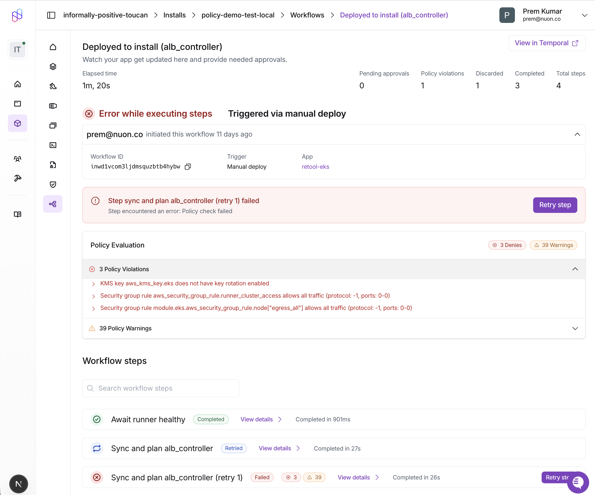

<Note>
  For background on policy concepts, types, and engines, see the [Policies concept page](/concepts/policies).
</Note>

## Prerequisites

Before starting, ensure you have:

- An existing Nuon app template with at least one component (terraform, helm, or container_image)
- The [Nuon CLI](/cli) installed and authenticated
- Basic familiarity with [OPA Rego](https://www.openpolicyagent.org/docs/latest/policy-language/) syntax

## Named checks

Use `package nuon.checks` to get a separate result for every named check in a
policy. Existing `package nuon` policies, including the examples below, continue
to use their existing `deny` and `warn` rules. Both formats can coexist in an app;
choose one format per policy file. No change to `policies.toml` is needed.

```rego
package nuon.checks

import data.nuon.lib.check

# METADATA
# title: No public buckets
# description: S3 buckets must not use public ACLs.
check_public_buckets contains check.finding(
    sprintf("Bucket %s has a public ACL", [resource.address]),
) if {
    some resource in input.plan.resource_changes
    resource.type == "aws_s3_bucket"
    changing(resource)
    resource.change.after.acl in {"public-read", "public-read-write"}
}

# METADATA
# title: Environment tags
# custom:
#   action: warn
check_environment_tags contains check.finding(
    sprintf("Resource %s is missing its Environment tag", [resource.address]),
) if {
    some resource in input.plan.resource_changes
    changing(resource)
    not resource.change.after.tags.Environment
}

changing(resource) if {
    some action in resource.change.actions
    action in {"create", "update"}
}
```

- Each `check_*` rule is a finding set. Multiple clauses with the same name
  contribute to the same check. Other rules and functions remain ordinary Rego
  helpers; reserve the `check_` prefix for checks.
- `check.finding(message)` is provided by Nuon. The message must be a nonempty
  string. Include resource identity in the message when findings should remain
  distinct: Rego sets deduplicate identical findings within an input. There is
  no explicit pass branch: an empty set passes.
- Metadata is optional. `title` defaults to the rule name; `description` is
  optional. `custom.action` can be `deny`, `warn`, or `skip_apply`: a check's
  action overrides the package default, which defaults to `deny` when omitted.
  `skip_apply` is supported only for `terraform_module` and `sandbox` policies.
  Attach at most one metadata block to a check, even when it has several
  clauses. It describes the whole check; `scope: document` is not required.
- Mixing legacy `deny` or `warn` rules into `package nuon.checks` is rejected.

### Package defaults

Place metadata immediately before `package nuon.checks` to set the default
action for checks in that policy file. No explicit `scope` is needed.
This example checks Pod objects only; it does not inspect pod templates in
Deployments, StatefulSets, Jobs, or CronJobs.

```rego
# METADATA
# custom:
#   action: warn
package nuon.checks

import data.nuon.lib.check

# METADATA
# title: Environment tag
check_environment_tag contains check.finding("Missing Environment tag") if {
    not input.review.object.metadata.labels.Environment
}

# METADATA
# title: No privileged containers
# custom:
#   action: deny
check_privileged contains check.finding(
    sprintf("Container %s is privileged", [container.name]),
) if {
    some container in input.review.object.spec.containers
    container.securityContext.privileged == true
}
```

For a Pod input, a missing label warns, while a privileged container blocks
deployment. Other workload kinds need checks for their pod-template paths.
The inheritance order is **check action → package action → deny**.

- Only `custom.action` inherits. Package `title` and `description` do not become
  check titles or descriptions. Check metadata that omits `custom.action`
  still inherits the package action.
- A check's action applies to all its clauses, regardless of which clause
  carries the metadata. Keep at most one metadata block per named check.
- Defaults stay local to the policy file. Other files using `package
  nuon.checks` have their own defaults.
- Actions must be `deny`, `warn`, or `skip_apply` at both levels. The same
  policy-type restrictions apply to inherited actions. Setting `custom.action`
  on a helper rule or function is rejected; unrelated helper metadata is allowed.
- Empty finding sets still pass. Evaluation errors still block, including
  checks that inherit `warn` or `skip_apply`.
- Legacy `package nuon` policies do not use this inheritance or validation;
  their existing `deny` and `warn` rules continue to determine the outcome.

**A package-level `warn` default also makes newly added checks warnings unless
they explicitly set `custom.action: deny`.**

### Automatically skipping apply

Use `custom.action: skip_apply` when a matching check should leave the existing
infrastructure unchanged instead of failing the workflow. This action is
supported only in named-check OPA policies with type `terraform_module` or
`sandbox`. It is not supported for Helm, Kubernetes, container image, or Pulumi
policies, or as a legacy `skip_apply` rule in `package nuon`.

For example, create `policies/skip-destructive-apply.rego` to skip an apply
when its plan includes a deletion or replacement:

```rego policies/skip-destructive-apply.rego
package nuon.checks

import data.nuon.lib.check

# METADATA
# title: Retain infrastructure on destructive changes
# description: Skip apply when the plan deletes or replaces a resource.
# custom:
#   action: skip_apply
check_destructive_changes contains check.finding(
    sprintf("Plan deletes or replaces %s", [resource.address]),
) if {
    some resource in input.plan.resource_changes
    "delete" in resource.change.actions
}
```

Register it in `policies.toml` for a Terraform component, a sandbox, or both:

```toml policies.toml
[[policy]]
name       = "retain-database"
type       = "terraform_module"
engine     = "opa"
components = ["database"]
contents   = "./policies/skip-destructive-apply.rego"

[[policy]]
name     = "retain-sandbox"
type     = "sandbox"
engine   = "opa"
contents = "./policies/skip-destructive-apply.rego"
```

Replace `database` with your component name. Sandbox policies are not scoped
by `components`. The action belongs in Rego metadata, not in `policies.toml`.

- An empty finding set passes and does not request a skip. Terraform
  replacements include `delete` in their actions, so this example matches
  replacements as well as deletions.
- A matching check skips the **entire component or sandbox apply**, not just
  the resources named in its findings. Existing applied state is retained;
  the proposed configuration is not recorded as applied. Other workflow steps
  can continue, but skipping initial provisioning does not create the
  infrastructure that later steps may need.
- Skip checks do not bypass denials or evaluation errors: those still block
  the change. Warnings can be reported alongside an automatically skipped apply.
- Policy reports show the skip findings and identify an apply that was
  **automatically skipped by policy**.

<Note>
  Policies run on teardown by default. This example can therefore also skip a
  component teardown or sandbox deprovision. To run the policy only during
  deploys, set `apply_on_teardown = false` on the relevant `[[policy]]` entries.
</Note>

### Check results

The policy report API includes `policies[].checks`, with one result per named
check, aggregated across the evaluated inputs:

| `decision` | Meaning |
| --- | --- |
| `pass` | Every evaluation succeeded and returned no findings. |
| `warn` | A warning check returned findings. |
| `skip_apply` | A skip check returned findings. The apply can be skipped if no policy denies or errors. |
| `deny` | A blocking check returned findings. |
| `error` | Input decoding, Rego evaluation, or finding validation failed. |

Each result includes `check_id`, `title`, optional `description`, `findings`,
`errors`, and `input_count`. Findings contain the authored message plus
Nuon-supplied `input_index` and, when available, `input_identity`. This identifies
the evaluated input, not an exact resource field or line within a plan. Engine
errors carry a code and message with the same input attribution. Evaluation
errors block the change, regardless of the check's configured action.

A runtime error, such as malformed JSON passed to `json.unmarshal`, prevents
that check from returning findings for the affected input. Findings from other
checks and successfully evaluated inputs remain in the report.

Missing fields have Rego's usual undefined behavior: a rule that accesses a
missing field may produce no findings. **Pass means no findings, not proof that
every expected field or resource was inspected.** Use explicit missing-field
checks where absence should block deployment.

Policy reports show the overall outcome alongside individual check results.
Skip findings are separate from warnings and denials. A check's `skip_apply`
decision alone does not mean the apply was skipped: another check can still
deny the change or fail evaluation.

### Testing locally with OPA

Nuon supplies its helper module automatically. With the standalone OPA CLI,
load `pkg/policies/opa/check.rego` from the matching Nuon source version alongside
your policy:

```sh
opa eval --strict-builtin-errors \
  --data /path/to/nuon/pkg/policies/opa/check.rego \
  --data policies/security.rego --input input.json \
  'data.nuon.checks'
```

This displays the raw finding sets, not Nuon's final policy decision or workflow
outcome.
Keep the input envelope appropriate to the policy type (`input.plan` for
Terraform, `input.review` for Kubernetes, or the image metadata input).

## Create the Policy Directory Structure

Create a `policies/` directory in your app root to store policy files:

```sh
mkdir policies
```

Your final directory structure will look like this:

```
myapp/
├── policies/
│   ├── require-signed-images.rego
│   ├── require-encryption.rego
│   └── require-resource-limits.rego
├── policies.toml
├── components/
│   ├── api_image.toml
│   ├── database.toml
│   └── api.toml
└── metadata.toml
```

## Add a Container Image Policy (Build-time)

Container image policies validate external images during the build phase. This example requires all images to be cryptographically signed.

Create `policies/require-signed-images.rego`:

```rego policies/require-signed-images.rego
package nuon

default allow := false

allow if {
    input.metadata.signed == true
}

deny contains msg if {
    not input.metadata.signed
    msg := sprintf("Image %s:%s must be signed", [input.image, input.tag])
}
```

<Note>
  For detailed container image policy patterns including SBOM validation and attestation checks, see the [External Image Policies guide](/guides/external-image-policies).
</Note>

## Add a Terraform Policy (Deploy-time)

Terraform policies validate the Terraform plan before applying changes. This example requires S3 bucket encryption and warns about missing tags.

Create `policies/require-encryption.rego`:

```rego policies/require-encryption.rego
package nuon

# Deny unencrypted S3 buckets
deny contains msg if {
    some resource in input.plan.resource_changes
    resource.type == "aws_s3_bucket"
    resource.change.actions[_] in ["create", "update"]
    not resource.change.after.server_side_encryption_configuration
    msg := sprintf("S3 bucket '%s' must have encryption enabled", [resource.address])
}

# Warn about missing Environment tag
warn contains msg if {
    some resource in input.plan.resource_changes
    resource.change.actions[_] in ["create", "update"]
    not resource.change.after.tags.Environment
    msg := sprintf("Resource '%s' is missing Environment tag", [resource.address])
}
```

## Add a Helm Chart Policy (Build-time and Deploy-time)

Helm chart policies validate rendered Kubernetes manifests. They run when the component is built and again when it is deployed to an install. This example requires CPU and memory limits on all containers.

Create `policies/require-resource-limits.rego`:

```rego policies/require-resource-limits.rego
package nuon

# Deny containers without resource limits
deny contains msg if {
    input.review.kind.kind == "Pod"
    some container in input.review.object.spec.containers
    not container.resources.limits.cpu
    msg := sprintf("Container '%s' must have CPU limits defined", [container.name])
}

deny contains msg if {
    input.review.kind.kind == "Pod"
    some container in input.review.object.spec.containers
    not container.resources.limits.memory
    msg := sprintf("Container '%s' must have memory limits defined", [container.name])
}

# Warn about missing resource requests
warn contains msg if {
    input.review.kind.kind == "Pod"
    some container in input.review.object.spec.containers
    not container.resources.requests
    msg := sprintf("Container '%s' should have resource requests defined", [container.name])
}
```

## Configure policies.toml

Create `policies.toml` at your app root to register each policy:

```toml policies.toml
# Container image policy - evaluated at build time
[[policy]]
type       = "container_image"
engine     = "opa"
components = ["api_image"]
contents   = "./policies/require-signed-images.rego"

# Terraform policy - evaluated at deploy time
[[policy]]
type       = "terraform_module"
engine     = "opa"
components = ["*"]
contents   = "./policies/require-encryption.rego"

# Helm chart policy - evaluated at build time and deploy time
[[policy]]
type       = "helm_chart"
engine     = "opa"
components = ["api"]
contents   = "./policies/require-resource-limits.rego"
```

### Policy configuration fields

| Field | Required | Description |
|-------|----------|-------------|
| `type` | Yes | Policy type: `container_image`, `helm_chart`, `kubernetes_manifest`, `terraform_module`, `kubernetes_cluster`, or `sandbox` |
| `engine` | No | Policy engine: `opa` or `kyverno` (default) |
| `name` | No | Human-readable name. If not specified, derived from the filename |
| `components` | No | Names of the components this policy applies to. Omit to apply to all components of the specified type. See [Scoping policies to components](/concepts/policies#scoping-policies-to-components) |
| `apply_on_teardown` | No | Set to `false` to skip this policy when a component is torn down or the sandbox is deprovisioned. Defaults to `true`. See [Skipping policies during teardown](/concepts/policies#skipping-policies-during-teardown) |
| `contents` | Yes | Inline policy content or path to policy file (e.g., `./policies/require-encryption.rego`) |

The `contents` field supports multiple source types. Relative paths are resolved from the `policies/` directory:

```toml
# Relative file path (relative to policies/ directory)
contents = "./require-encryption.rego"

# HTTP/HTTPS URL
contents = "https://example.com/policies/security.rego"

# Git repository (the `//` separates the repo from the path to the file)
contents = "git::https://github.com/org/policies//terraform/encryption.rego"

# Git repository, pinned to a ref (branch, tag, or commit)
contents = "git::https://github.com/org/policies//terraform/encryption.rego?ref=v1.2.3"
```

## Ship Your Policies

Policies ship with the rest of your app config. Commit them and push to the git branch your
[app branch](/guides/app-branches) tracks:

```sh
git add policies.toml policies/
git commit -m "add policies"
git push origin main
```

The push starts a branch run, which parses and uploads your policies along with components and other configuration.

## Observe Build-Time Evaluation

Container image and Helm chart policies are evaluated when you create a build. Trigger a build for your image component:

```sh
nuon builds create -c api_image
```

If the image is not signed, the build fails with `policy_failed` status:

```
Creating build for api_image...
✗ Build failed: policy check failed
  - require-signed-images: Image nginx:latest must be signed
```

If the image passes all policy checks, the build succeeds:

```
Creating build for api_image...
✓ Build created: bld_abc123
✓ Policy checks passed
```

## Observe Deploy-Time Evaluation

Terraform and Helm policies are evaluated during deployment. Deploy your components to an install:

```sh
nuon installs deploy -i <install-id>
```

After the deployment starts, list the workflow steps to see policy results:

```sh
nuon installs workflows steps list -w <workflow-id>
```

The output shows policy status for each step:

```
Step              Status    Policy
deploy-database   error     ✗ 1
deploy-api        success   ⚠ 2
```

- `✗` indicates deny violations that blocked the step
- `⚠` indicates warnings that were logged but allowed the step to continue
- `✓` indicates all policies passed

Get detailed violation messages for a specific step:

```sh
nuon installs workflows steps get -w <workflow-id> -s <step-id>
```

```
Step: deploy-database
Status: error

Policy Violations:
  ✗ require-encryption: S3 bucket 'module.db.aws_s3_bucket.backup' must have encryption enabled

Policy Warnings:
  ⚠ require-encryption: Resource 'module.db.aws_rds_cluster.main' is missing Environment tag
```

## View Results in Dashboard

Policy results are also visible in the Nuon Dashboard:

1. Navigate to your install's **Workflows** tab
2. Select the workflow run
3. Click on a workflow step to view details
4. The **Policy Report** card shows:
   - **Passed**: Green checkmark if all policies passed
   - **Denies**: Red indicators with violation messages
   - **Warnings**: Orange indicators with warning messages
   - **Automatically skipped by policy**: Skip findings explaining why the component or sandbox apply was skipped

Each finding displays the policy name and the authored message from your rule or named check. Skip findings are separate from warnings and denials.



<Tip>
You can also view policy results via CLI using `nuon installs workflows steps get -w <workflow-id> -s <step-id>`.
</Tip>

## Fix Policy Violations

To resolve policy violations, update your components to comply with the policies:

**For container images**: Sign your images using [cosign](https://github.com/sigstore/cosign) or another signing tool before pushing to your registry.

**For Terraform**: Add the required configuration to your module:

```hcl
resource "aws_s3_bucket" "backup" {
  bucket = "my-backup-bucket"

  tags = {
    Environment = "production"
  }
}

resource "aws_s3_bucket_server_side_encryption_configuration" "backup" {
  bucket = aws_s3_bucket.backup.id

  rule {
    apply_server_side_encryption_by_default {
      sse_algorithm = "AES256"
    }
  }
}
```

**For Helm charts**: Add resource limits to your pod specs:

```yaml
containers:
  - name: api
    resources:
      limits:
        cpu: "500m"
        memory: "512Mi"
      requests:
        cpu: "100m"
        memory: "128Mi"
```

After making changes, push them to the tracked git branch. The push starts a branch run that plans and deploys the
change, one deployment group at a time:

```sh
git commit -am "fix policy violations"
git push origin main
```

Confirm the policies now pass:

```
Step              Status    Policy
deploy-database   success   ✓
deploy-api        success   ✓
```

## Next Steps

- [External Image Policies](/guides/external-image-policies) - Advanced patterns for container image validation including SBOM, attestations, and signature verification
- [Example Policies Repository](https://github.com/nuonco/policies) - Ready-to-use policy examples for Terraform and Kubernetes
- [Policies Configuration Reference](/config-ref/policies) - Complete schema reference for policy configuration
