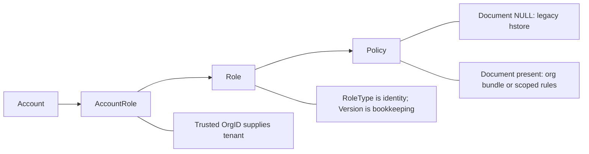

# RBAC foundation: existing boundaries, new policy model

**008 · Boundary-preserving activation plan · 4 November 2026**

**Status, 16 November 2026: delivered and running in production.** Sections 1–4 remain the contract. Sections 5–6
are the historical rollout record; where they say "local", "unregistered" or "remaining", the shipped state below wins.

| PR | Contents | Production |
| --- | --- | --- |
| [#3185](https://github.com/nuonco/nuon/pull/3185), [#3192](https://github.com/nuonco/nuon/pull/3192) | Foundation PRs 1–3; duplicate-binding cleanup and live-binding index | yes |
| [#3258](https://github.com/nuonco/nuon/pull/3258) | Compatible readers: optional `api`, scoped `resource_rules`, document-aware reconciliation and stack adoption; 153 document-aware | 0.19.1293 |
| [#3246](https://github.com/nuonco/nuon/pull/3246) | v3 writers for standard and scoped roles, `policies_single_authority` CHECK, classifier, migration `156-convert-standard-org-roles`, legacy-safe 126/150 | 0.19.1295 |
| [#3277](https://github.com/nuonco/nuon/pull/3277) | Runtime registration of the AccountRole join model (revoked bindings no longer load) | 0.19.1296 |
| [#3275](https://github.com/nuonco/nuon/pull/3275) | Admin-migrate creates v3 runner roles (last v2 writer) | merged, pending deploy |

Differences from the plan text below:

- `log_stream` roles are converted and written as v3 `resource_rules` (`log_stream.create` on the exact stream), not kept legacy.
- Unbound runner-install roles were converted too, under the later "convert every exactly representable role" decision.
- Migration 156 exceeded the 5-minute startup deadline in production after 27,566 roles; the expired context left its
  row `in_progress` and the retry skipped it, so the deploy reported success. It was recovered with
  `DB_MIGRATIONS_TIMEOUT=20m`. The migrator fix is tracked separately.

Production census on the read replica, 16 November 2026 11:48 UTC (`.amp/in/artifacts/rbac-closeout-census-20261116/`):
the only live legacy policies are the three v1 `hosted-installer` roles with wildcard authority; no v1/v2 role was created
after 156; zero dual-authority policies. 54,858 runner-install roles have no binding and no managed-owner reference
(created 29 October–12 November, none since); 113 Reader roles belong to deleted orgs. Their cleanup is separate work.

Enforcement is unchanged: routes still derive create/read/update/delete from the HTTP method and the legacy adapter maps
v3 grants onto those checks. Section 7 and spec 007 own what comes next.

## 1. Ship today's boundaries on the new foundation

Adopt [006's catalog, policy, scope and evaluator model](../006-control-plane-authorization/authorization-model.md)
without requiring its full security cutover. Start with today's **Read-only (`org_read_only`)** and **Admin (`org_admin`)**
at org scope, then include recognized machine-policy shapes using separate permissions and scopes. Preserve who
can access what. Later resource-boundary changes must be explicit increments.

| In this activation | Out of scope |
| --- | --- |
| Minimal Reader `{org.read}` and Admin `{org.read, org.write}` bundles; exact scoped compatibility grants | Org Editor, new customer role-management APIs, route remaps |
| Exact existing v1/v2 standard-role conversion, followed by recognized machine shapes once writers are ready | Unknown/custom policy inference, historical grant repair, promising zero legacy rows |
| Optional legacy `api` metadata to preserve existing restrictions | Token audiences, OAuth resource approval, issuer or credential rewrites |
| Existing API guards, token restrictions, Admin-only checks and transport distinctions | Moving enforcement, tighter security boundaries, role-guard retirement |
| One skip-version-capable release, accepting transient mixed-version errors | Mandatory intermediate releases, zero-downtime activation gate, separate apply CLI |
| Existing migrator, atomic row updates, idempotent conversion | Migration-harness rewrite, new scheduler/progress tables, global mutation locks |

The model remains identity-neutral: all accounts use roles, policies and the same matcher. There is no customer-only
permission category. New recognized machine/private roles use scoped documents. Exact Support/Installer/Runner
org-wide grants reuse the full-access bundle without changing role identity. Builder, hosted-installer and unknown
custom shapes remain legacy, as does main's newer log-stream role; conversion requires exact contents and verified
ownership, not role-name inference. Preserve log-stream creation and its existing runner API restriction without
adding log-stream documents or broadening this converter.
No new account, binding, token, OAuth, invitation or workflow schema is needed for the scoped extension.

The previous audience redesign is **deferred in its entirety**. Its [source inventory](issuance-inventory.md) is
future design material, not a dependency or acceptance gate here. Action tokens, session/admin cookies, specialized
phone-home receivers and historical credential ownership do not need redesign to convert these two standard roles.
No new token audience column, validation, backfill, rotation, consent flow or issuer default is introduced.

The rebased main includes [#3197](https://github.com/nuonco/nuon/pull/3197), which blocks REST writes for read-only
OAuth tokens. Preserve it. Earlier foundation evidence describing REST/MCP differences predates that change;
do not restore the earlier REST behavior or tighten other credential behavior incidentally.

## 2. Data model and document contract



The deployed foundation adds nullable `Policy.Document` JSONB without a default or index. `AccountRole.OrgID` remains
the binding's tenant. Org bundles use that org as their scope; resource rules name their narrower scope in the policy.
Existing role IDs, contexts, metadata, associations and Admin identity are retained. No binding schema changes or
`OrgGrant` abstraction are needed; use `ScopedPermissions{Scope, Permissions}`.

| Persisted state | Reader contract |
| --- | --- |
| SQL NULL document | Use legacy hstore and existing v1/v2 interpretation. |
| Present document | Use v3 independently of Role.Version; do not retry legacy on error. |
| JSON null, malformed/unsupported document, or document with nonempty hstore | Fail loading; no fallback or partial authority. |
| Valid document with stale Role.Version | Document still selects v3. Do not reject solely for bookkeeping drift. |
| SQL NULL document with Role.Version 3 | Legacy branch; never reconstruct authority from the role label. |

Hstore and document must be fetched from the same policy row. Separate role/policy preloads can observe stale
bookkeeping without choosing the wrong format. This does not introduce new atomic revocation semantics.

`Document []byte` stays absent from public JSON and included in Temporal serialization. Its byte representation
preserves SQL NULL versus the JSON literal `null`; the current converter's `json.RawMessage` roundtrip does not.

### Optional api preserves old behavior; it is not new token audience support

Exact v1 Reader after conversion:

```json
{"kind":"bundle","binding_kind":"org","permissions":["org.read"]}
```

Exact v2 Admin after conversion, also the shape for newly created Admin roles:

```json
{"kind":"bundle","api":"ctl-api","binding_kind":"org","permissions":["org.read","org.write"]}
```

| Field | Contract |
| --- | --- |
| `kind` | Required, `bundle` or `resource_rules`. Each has its own strictly decoded fields. |
| `binding_kind` | Required, exactly `org`. Org identity comes from trusted records, not the document. |
| `permissions` | Required non-null array for a bundle, or within each resource rule. Empty grants nothing; writers sort/deduplicate. No bare CRUD strings or wildcard permissions. |
| `rules` | Required non-null array only for `resource_rules`. Each rule has an explicit scope and permission array; empty grants nothing. |
| `api` | Optional. Absence contributes no legacy API restriction. Present values must be `ctl-api`, `runner` or `stack`; null, empty, unknown, `all` and wrong types are rejected. |

Reject unknown/duplicate fields, malformed JSON and trailing data. Duplicate fields must be rejected before JSONB
normalization. Use the existing `permissions.Policy` codec, not a third document format or public wrapper type.

The pure codec understands the catalog without classifying principals. Org-bundle runtime integration accepts only
empty, minimal Reader and minimal Admin sets. Resource-rule integration accepts the exact mappings below. Other
codec-valid sets, such as `{org.write}` or `{org.read, install.read}`, must fail integration explicitly, not grant `all`,
disappear silently or fall back to hstore. Permission applicability belongs in the matcher; the compatibility adapter
separately limits what can be represented by today's route verbs and response maps.

The deployed R1 codec requires `api`. The next reader release accepts its absence and preserves absence when
serializing. This is an explicit compatibility extension: R1 cannot read audience-neutral documents.

### Scoped rules separate what from where

An install's telemetry grant is represented as:

```json
{
  "kind": "resource_rules",
  "binding_kind": "org",
  "rules": [
    {"scope": {"kind": "install", "id": "install_acme"}, "permissions": ["telemetry.all"]}
  ]
}
```

The same install scope can carry `stack.all`, independently or alongside `telemetry.all`. Neither implies
`install.all`, org access, or phone-home access. The org comes only from the validated role/policy/binding records;
`scope.org_id` is rejected. Scope IDs must be explicit, without wildcard or legacy-key separators.

| Existing scalar grant | V3 scope | V3 permission | Preserved operation boundary |
| --- | --- | --- | --- |
| `<org>:install/<install>` → all | install / install ID | `install.all` | Exact install object, not every child namespace |
| `<org>:telemetry/<install>` → all | install / install ID | `telemetry.all` | Only that install's telemetry object |
| `<org>:stack/<install>` → all | install / install ID | `stack.all` | Only that install's stack object |
| `<org>:runner-job/<job>` → all | runner-job / job ID | `runner_job.all` | Only that job object |
| `<org>:phone_home/<version>` → create | phone_home / stack-version ID | `phone_home.create` | Create on that exact version callback only |

`phone_home` scope names an exact stack-version callback, not an install. Conversion must preserve that version ID.
An install-wide phone-home permission would broaden historical access to other versions and is not enabled by this
extension. A future explicit install-wide grant would need server-resolved version→install ownership.

The `.all` IDs are named, finite catalog bundles, not prefix wildcards. The pure matcher recognizes their explicitly
listed operations only within the bundle's target kind; `stack.all` must not gain phone-home access through the
existing `stack.report` permission. New catalog members do not automatically join a bundle. The legacy adapter
preserves the old scalar `all` behavior, including its existing unknown-verb behavior, on the exact original key.

Multiple permissions at the same install scope can share a rule. Rules that produce the same legacy object twice
are rejected rather than applying order-dependent intra-document merging. Across roles, the existing reducer remains
unchanged. Its surviving sources keep separate permission sets so one surviving namespace cannot resurrect another.

No resource existence scan is added to request authentication. Existing route ownership checks remain responsible
for resolving resources. The planned converter must independently validate source ownership before writing rules.

## 3. Keep authorization and wire behavior unchanged

`APIFromRole` inspects documents before its legacy version check. For document policies, a missing `api` contributes
no restriction even with Version 3; a present value retains its restriction. Legacy v1/v2 behavior remains unchanged,
including errors for malformed v2 API metadata. No `api: all`, role-name inference or implicit ctl-api default.

Keep `APIForRoles` and assignment compatibility checks at their existing sites. REST continues to consider the entire
account role set, including other orgs. MCP does not acquire that whole-account API guard. Existing MCP static-token,
account-type and membership checks remain. The shared permission loader must not become a new audience gate.

For document-backed roles, validate one live policy and live bindings/accounts/orgs, matching RoleID and OrgID across
associations. Never infer missing ownership from request headers or silently repair bindings. The merged unique live
account-role index remains a prerequisite, not new cleanup work in this branch.

### Preserve the deployed decision adapter

| Existing requirement | V3 mapping | Legacy path |
| --- | --- | --- |
| Read / GET / HEAD | `org.read` at the verified org | Original read with existing object/org/wildcard fallback |
| Create / update / delete | `org.write` at the verified org | Original CRUD verb; no collapsed write permission |
| MCP read-only credential | Existing org.read ceiling | Existing write denial applies to legacy grants too |
| Scoped resource verb | Exact compatibility mapping above; read-only credentials still reject non-read operations | Original resource key and verb |
| Unknown verb in `require` | Existing configuration error | Same error |
| Unknown verb in org middleware | Actual minimal full-access contribution, subject to credential limits | Existing all matches unknown |

Keep existing REST token restrictions, ownership checks, runner/stack guards, error conventions and Admin-only checks.
Explicit `require.Route` verbs do not override an earlier middleware check. Support/all is not Admin identity.

The compatibility reducer preserves the supplied Roles sequence: first `all` survives; otherwise the last scalar
contribution wins for an object. Only surviving contributions reach the v3 matcher or legacy adapter. Do not allow
an overwritten read grant to reappear through an independent old/new union. Exact resources, parent org and wildcard
keys remain distinct. The pure v3 matcher still uses scoped grant union intersected with the synthesized ceiling.

Unordered SQL preloads never promised stable ordering. Do not add sorting or account-wide historical replay as a new
subsystem. Classify Reader holders with another same-org create/update/delete scalar as ambiguous and leave those
candidates legacy. Ordinary Admin/Reader combinations and independent resource keys are not excluded wholesale.

### Response projection is not authority

Keep `Account.permissions` and policy permissions as string maps. Minimal Reader projects org → read; Admin projects
org → all. Scoped rules project their exact original resource key and scalar verb, never the parent org or another
namespace. Include the `api` entry only when it is actually retained in the document. Empty policies without api
project an empty map. Do not manufacture an api entry or persist the projection.

Existing decisions continue using loaded authority, not response maps. Keep public/internal serialization and Temporal
raw-policy roundtrips compatible. No public API schema or client shape changes are required.

## 4. Classify exact source records, not role labels

The classifier now covers the five standard org-role types and the five recognized scoped role types. Scoped runtime
support alone is insufficient: conversion independently verifies the source grant and its ownership records.

`authz.ClassifyOrgRole` is pure and shared by inventory and the converter. It returns `eligible` with the typed target
policy, permission IDs and optional legacy API metadata, `already_v3`, a named `skipped` reason, or an invalid-document error.
It does not write records, encode an alternative format, repair bookkeeping or infer a document from a role name.

| Source | Disposition |
| --- | --- |
| Live v1 standard Reader/Admin with exact `{org: read/all}` | Eligible without api. |
| Live v2 standard Reader/Admin with exact `{org: read/all, api: ctl-api}` | Eligible retaining ctl-api. |
| Exact Support/Installer/Runner `{org: all}` | Eligible without api at v1; v2 retains ctl-api for Support/Installer or runner for Runner. RoleType is unchanged. |
| Exact runner-install, runner-job, stack, telemetry or version-phone-home shape | Eligible after scoped ownership checks; v1 omits api, v2 retains the valid stored API. |
| Valid integration-supported stored document | Validate and leave unchanged, including stale Role.Version. |
| Builder/hosted-installer/unknown custom roles; other versions or shapes | Leave legacy and report reason. |
| Missing/deleted/mismatched ownership, duplicate bindings or standard roles, ambiguous custom combinations | Skip/review; no repair or grant resurrection. |
| Present malformed/nonminimal document or conflicting hstore | Error, never fallback or successful conversion. |

Require exactly one live policy with matching role/org ownership. An unbound standard org role is valid. V1 with extra api metadata,
extra resource/wildcard keys or custom CRUD values is not an exact candidate. New role metadata is not proof of old
policy contents. Standard org roles with private ownership remain excluded. Scoped roles require exactly one live
service-account binding, no managed-role flag or selectable contexts, and matching live resource/org relationships.

Runner-install ownership follows the account's exact subject to a runner, or a job then its runner, and checks the
runner group's install owner. Stack ownership follows the subject to its install stack. Runner-job ownership checks
the subject against the exact job. These paths accept historical missing managed-account rows only with that live
resource evidence. Telemetry and phone-home require explicit managed ownership. Phone-home additionally verifies the
exact version, stack and install chain, and the binding's version instance key. Present deleted/conflicting managed
ownership is never treated as missing. Private-role references must agree with the bound account. Missing/deleted or
ambiguous sources are skipped, not repaired; no subject/email heuristics or install-wide callback inference.

Load raw snapshots without runtime Account/Policy projection hooks. `OrgRoleSnapshot.Role` includes its actual org
and all live raw policies; `OrgRoles` includes live same-type roles for standard-role uniqueness. `Bindings` includes
all live bindings to the source and their actual accounts. Standard candidates also load holder roles/raw policies;
scoped candidates instead load `Resource` ownership records by exact IDs. `Private` comes from managed ownership
references. Scoped candidates do not scan every role in their org. Missing/deleted records remain observable.

Keep bounded source loading and stable-ID enumeration outside the classifier. A disposable read-only harness is
sufficient; no startup scan, public endpoint, permanent apply command or feature flag. Report raw population counts
and exceptions independently of eligibility, including policies with no live owner. Resource IDs belong in restricted
logs, not metric labels. Refresh production classification before activation.

## 5. Activation increments retain real deployment boundaries

The original org-role increments are implemented locally as follows. The approved scoped extension adds readers
now and requires corresponding writer/converter follow-through before machine-role conversion is released.

| PR | Scope | Exit evidence |
| --- | --- | --- |
| 4 — Read-only classifier | Exact v1/v2 standard-role classification and raw inventory; no live behavior change | Exact/near-miss fixtures, mixed contributions, existing-document validation, read-only census |
| 5 — Compatible policy readers | Optional legacy api plus scoped resource rules in the existing codec, API derivation and wire projections; keep all guards | Absent versus invalid api, scoped namespace/version isolation, unchanged v2 restrictions, mixed roles, assignment checks, serialization, legacy parity |
| 6 — New-role writers | All five standard org-role factories and five scoped-role paths use compatible v3 policies | Factory/reconciliation/assignment checks; existing formats/API restrictions remain unchanged |
| 7 — Exact conversion | Registered migration reusing classifier; v1 omits api and v2 retains it | Atomic updates, retry/no-op/error behavior, before/after decisions and maps, bounded runtime, explicit exceptions |

This replaces the superseded PRs 4–8 audience/activation sequence. Token audience readers and credential issuers are
not an intermediate milestone. The issuer inventory is deferred, not part of PR 4's completion criteria.

### Scoped writer implementation and remaining activation work

New runner-install, runner-job, stack, telemetry and version-phone-home roles use the exact rules above through the
shared private-role persistence path. Existing desired-role factories retain their scalar templates; persistence
validates their shape and writes document-only v3 policies. Runner-install and runner-job retain runner API;
new stack roles retain stack API; telemetry and version-phone-home retain no API restriction.

Reconciliation locks the existing role and preserves its storage format, IDs, version and document API restriction,
including absence. It compares semantic projections before writing, and updates document/hstore atomically.
Stack adoption understands either format. Historical v1/v2 stack convergence remains unchanged, including
read-to-all and stripped-v2-API restoration. Missing v3 policy documents fail instead of reconstructing a lost API
restriction from defaults. Existing roles are not converted opportunistically by these writers.

The shared classifier and still-unreleased migration 153 now implement these recognized shapes. Support/Installer/
Runner new-role factories also write v3, preserving their identity and API guard, so they do not keep introducing
legacy rows after conversion. Existing standard-role reconciliation remains metadata-only.

Remaining: refresh the read-only production classification and verify rollout ordering. The 24,028 runner-install
roles are a population count, not an eligibility count; they include roles held by runner-job accounts. Hosted-installer
contents remain unverified and excluded. Do not assume every historical record is convertible.

One conversion migration can cover all verified supported shapes ready before that converter ships.
Later shapes require a later migration; an applied migration must not be edited to pick them up.

### Accepted single-release rollout

Ship compatible readers and reconcilers, all recognized v3 creation paths, and the expanded converter together.
Customers may upgrade directly from supported legacy versions. Do not require the separately prepared
`ps/rbac-compatibility` artifact to be deployed first; preserve it as a recovery candidate, not a rollout dependency.

Accepted effects during upgrade:

- Old APIs/workers can reject converted policies until replaced. Temporary request and workflow-activity failures
  are accepted, not evidence of changed intended permission semantics.
- Legacy roles created after the converter passes can remain legacy. New readers support them; a future explicitly
  numbered catch-up migration can handle them. Zero legacy rows is not an acceptance criterion.
- No maintenance window, global mutation pause, audience redesign or runtime activation flag is required by this plan.

Failures must settle after all target processes are running. Persistent mixed authority, permission broadening,
silent historical-migration corruption and rollback to incompatible readers remain outside that acceptance.

### Deployment ordering established from source

- Cloud: `mono/services/ctl-api/k8s/templates/startup.tpl` runs the target image's startup as a Helm
  `pre-install,pre-upgrade` hook. Old APIs/workers remain live during migration. `nuonctl` enables
  `RollbackOnFailure`; Helm rollback does not undo database conversion.
- BYOC AWS/GCP: `deploy_control_plane` deploys the chart, then invokes the post-deploy startup action. The pinned
  charts start API containers normally while the startup deployment waits for an explicit exec. Both startup actions
  default `SCALE_DOWN=false`; optional draining continues after timeout and is not a strict compatibility barrier.
- These are repository-source observations, not a census of every customer's installed configuration.

### Current implementation versus the accepted plan

| Area | Current source state | Reconciliation needed |
| --- | --- | --- |
| Readers and reconciliation | Rebased branch retains optional-api/scoped readers, document-aware private reconciliation and stack adoption. | Targeted package checks passed; full upgrade/recovery rehearsal remains outstanding. |
| Standard/private writers | Five standard types and five recognized scoped types write v3. Log-stream creation explicitly stays legacy. | No additional policy shape is introduced. |
| Log-stream integration | `ensurePrivateRole` limits v3 construction to the five supported scoped types. | Disposable PostgreSQL verified log-stream create/repeat and exact boundaries; the pre-fix helper fails the same scenario with unsupported `log_stream`. |
| Cleanup integration | Main's `RoleType.IsPrivate`, `DeletePrivateRoles`, log-stream-account deletion and queued cleanup callers are retained. The removed `DeleteStackInstallRoles` is not restored. | Disposable PostgreSQL verified deletion of legacy log-stream and v3 install policies while preserving a standard role/binding. Concurrent cleanup/conversion and full credential-cleanup workflow rehearsal remain outstanding. |
| Converter | Expanded converter is renamed 155; snapshot/classification files remain restored and untracked as before. `Migrations.All()` includes main's 153/154, excludes conversion. | Register conversion only after the remaining safeguards; no migration was executed by the registry check. |
| Historical migrations | Main's 153 still reads/writes hstore without checking `Document`; 126/150 still use current reconciliation. | Skip-version compatibility remains unresolved; the earlier plan did not implement it. |
| Database safeguard | `Policy.Document` declares `policies_single_authority` through GORM schema migration, before global migrations. | Disposable PostgreSQL verifies installation, legacy upgrade, rejection of stale writes and invalid existing rows, rerun and lock-deadline recovery. Production validation cost and BYOC schema-before-writer deployment ordering remain outstanding. |
| Compatibility artifact | `ps/rbac-compatibility` remains on [57c4ae9a9c](https://github.com/nuonco/nuon/commit/57c4ae9a9c) with 12 local reader/reconciler files; it is 20 main commits behind. | Preserve it, but do not call it a tested recovery image for the latest combined source without rebuilding/reverification. |
| Production cleanup and scale | Main merged [#3211](https://github.com/nuonco/nuon/pull/3211), [#3212](https://github.com/nuonco/nuon/pull/3212) and [#3179](https://github.com/nuonco/nuon/pull/3179). | Merged lifecycle cleanup is not proof that historical million-holder bindings were removed. No fresh shared DB census was run; keep the scale rehearsal deferred. |

`scoped_role_snapshot.go` supplies live/deleted ownership evidence to classification for the five
supported scoped role types. It does not perform cleanup, register conversion, enforce rollout order or support the
new log-stream type. Keep that boundary unchanged unless a separately approved conversion shape requires more.

### Bounded implementation and verification work

1. Main integration and overlap resolution are complete locally. Log-stream creation stays legacy; main's private-role
   validation/deletion, credential-cleanup callers, telemetry guard and log-ingest alternatives are preserved. The
   converter is renumbered 155 and still unregistered. The compatibility worktree is untouched.
2. Make historical migrations safe under the target binary. Migrations126/150 call current role reconciliation and
   can therefore create v3 before main's153 runs. Keep their missing-role creation legacy, and make153 explicitly
   document-aware so it cannot add hstore beside a document. Preserve already-recorded migration identity and avoid
   opportunistically changing existing document restrictions. Rehearse both skipped-version and already-migrated data.
3. Prevent a stale old writer from restoring nonempty hstore beside a document. A database CHECK matching the existing
   reader invariant is implemented: `document IS NULL OR permissions IS NULL OR permissions = ''::hstore`.
   Application checks and converter row locks cannot constrain an already-running old binary. This constraint is
   installed in the model schema phase before all global migrations, including149. Actual migrator verification
   passed on disposable Policy schemas; production-scale validation/locking cost remains deferred until cleanup.
   BYOC currently starts writers before startup, so placing the guard only at converter entry would leave an earlier
   race. Resolve this schema-before-writer ordering in the deployment path; do not claim that fast conversion fixes it.
4. Verify the full target through disposable PostgreSQL: historical migrations, new standard/private creation,
   legacy log-stream creation, converter, rerun, compatible reconciliation and deletion of v3 private roles.
   Force a stale update after conversion and assert failure without row corruption. Include cleanup/deletion overlap,
   late legacy insertion as an accepted control, and authorization projections. Earlier isolated-reader checks do not
   establish these combined-source results.
5. Prepare release recovery: suppress automatic rollback to an incompatible image once v3 writes/conversion can occur.
   Prefer roll-forward with the target or a verified compatible recovery image. Do not restore hstore from role names.
   An early BYOC writer failure before schema preparation must not be silently treated as a successful upgrade.

The rebase and log-stream overlap fix are local; no deployment configuration changed. The converter remains
unregistered pending the remaining safeguards. Shared migration execution, deployments and cleanup remain unauthorized.

### Verification evidence and remaining release gates

Rebase verification used six existing package suites with `-count=1 -race`: authz, permissions, require, app, account
and PostgreSQL migrations. Disposable PostgreSQL exercised actual role creation/reconciliation/deletion helpers and
the migration registry; it was not a full startup or transport E2E test. The negative control restored the pre-fix
private-role helper with the existing exported adapter name and failed on log-stream creation. The fixed helper passed.
The full ctl-api build passed after regenerating ignored Temporal wrappers for the newly integrated main code.
Logs and preservation hashes are in `.amp/in/artifacts/rbac-rebase/`. The initial scratch fixture mistakenly used
`log-stream` instead of the actual `log_stream` namespace; that fixture was corrected before the final passing run.

A disposable PostgreSQL SQL replay reproduced the specific old-writer update after conversion: without a constraint,
both authority formats persisted. With the proposed CHECK, PostgreSQL returned SQLSTATE23514 and left the row
unchanged. Late legacy insertion and empty hstore alongside a document remained allowed, matching the reader contract.
Evidence: `.amp/in/artifacts/rbac-single-release-overlap.json`. This is a replay of the relevant SQL statements, not
an old-binary, full-migrator or deployed E2E test. The disposable database was removed.

The CHECK implementation additionally passed a disposable PostgreSQL probe using `Migrator.Exec`, `app.Policy` and
a global sentinel asserting the constraint is validated before global execution. Fresh and pre-document schemas,
legacy/document/empty-hstore cases, JSON null and NULL-valued hstore keys, soft-deleted rows, a stale-writer transaction,
invalid existing data, repeated migration and deadline/retry under a blocking table lock were exercised. Removing the
CHECK reproduced the conflicting write. Relationship/FK migration was disabled to isolate Policy; this was not full
startup, execution of149/153/155, an old-binary deployment or a scale rehearsal. Logs are in
`.amp/in/artifacts/rbac-policy-check/`; initial probe failures were verifier assumptions about GORM's translated errors
and dropping/recreating hstore with cached statements, corrected before the final passing run. No shared DB changed.

Existing compatibility verification remains useful but is not proof of the combined artifact. Its old-reconciler
negative control also rewrote writer-produced policies; the compatible reconciler preserved them. The compatibility
artifact and the writer work remain local and uncommitted where previously recorded.

After cleanup, refresh eligibility/cardinality counts and rehearse the remaining scale; this work is deferred, not
waived. Budget the existing startup deadline shared by PostgreSQL and ClickHouse. Capture migration status plus
eligible/skipped/converted counts and post-rollout conflicting-authority counts. Compare authorization errors against
baseline after all target consumers have replaced old processes; transient overlap failures are accepted, persistent
failures are not. Verify Admin/Reader read/write, cross-org denial, read-only OAuth/MCP and runner/stack callbacks.

### Conversion mechanics

The retained converter (originally `153-convert-standard-org-roles`, pending renumbering) uses the existing startup
framework and 100-role stable-ID batches,
not offsets over a shrinking cohort. Re-read and classify each candidate and its associations in a short repeatable-read
transaction, locking the candidate role and its live policies. Use raw scans to avoid runtime projection hooks.
Conditionally update the policy row's document and clear hstore **together**, verifying the original full shape.
Update Role.Version to 3 in that same transaction; require expected affected-row counts and roll back on failure.
Preserve policy/role/binding IDs and metadata. Changed candidates are reclassified or skipped, not overwritten.
Concurrent source updates that invalidate the snapshot propagate a serialization failure; reinvocation reclassifies
the current state. There is no unbounded retry loop or global lock on role assignment.

Already-converted rows are no-ops. Partial conversion leaves readable mixed-format data; reinvocation processes the
remaining eligible rows. Malformed/unsupported present documents propagate errors. Measure a representative run
against the existing startup timeout before deciding whether its existing override is needed.

Normal valid assignment/removal may overlap conversion: bindings reference existing roles rather than copying
policy data. Do not add shared role locks to every writer or pause all membership/machine provisioning. If a writer
can mutate a candidate policy incompatibly, handle that specific conflict before rollout.

**Accepted harness assumption:** scheduling, claims, status persistence and retry delivery belong to the existing
migrator. Its known recovery/reporting issues remain separate maintenance work. PR 7 owns atomicity, idempotency,
accurate results and error propagation when called, not a framework rewrite or process-crash recovery subsystem.

### Rollback floor and completion

The first document **without api** raises the rollback floor to the compatible reader release; R1 would reject it. Do not
remove a retained api restriction to bypass validation, restore hstore speculatively, or roll back to an incompatible
reader. Keep legacy API guards indefinitely until their own separately reviewed cutover.

The first `resource_rules` document additionally requires scoped readers for successful requests. The optional-api-only
checkpoint cannot read it. Old-process failures during replacement are accepted; those processes cannot be a recovery
target after activation.

A recovery image must include document-aware reconciliation and stack adoption. The bare scoped-reader checkpoint
`0f60e62359` is not safe: it lacks document-aware reconciliation and stack adoption. Any recovery deployment must
preserve the schema, binding index and stored documents; do not roll back to the merged foundation or restore hstore.
The former A/B/C labels describe historical packaging only, not mandatory sequential deployments.

If a compatible recovery image resumes v2 creation after conversion was recorded, reclassify and add an explicit
catch-up migration when needed. Startup does not rerun an applied migration. Do not add hypothetical catch-up code now.
Completion means new standard creation is v3 and exact conversions/exceptions are accounted for—not zero legacy rows.

## 6. Verification and evidence

Use existing tests and disposable PostgreSQL/API fixtures. Package guidance requires explicit approval and a choice
of test form before adding permanent tests. Source review alone is not production or deployment proof.

| Risk | Distinguishing checks |
| --- | --- |
| Optional api broadens restrictions | Omitted api versus null/empty/all/unknown/wrong types; retained values roundtrip; invalid v2 remains invalid |
| V1 conversion gains a guard | Mixed neutral document + legacy runner role behaves like original v1 + runner; no fake api response entry |
| V2 conversion loses a guard | Retained ctl-api + runner remains rejected by REST and assignment compatibility; MCP guard placement unchanged |
| Incorrect permission composition | Both read/create orders; all in either order; independent org/resource/wildcard keys; read-only ceilings |
| Wrong authority source | SQL NULL versus JSON null; stale version; malformed/nonminimal document; no hstore fallback |
| Ownership/identity drift | Deleted/missing/mismatched associations, duplicate bindings/roles, private roles; Support/all does not become Admin |
| Wire/serialization regression | Account/policy maps, empty bundles, raw policy Temporal roundtrip, no persisted projection |
| Writer or converter scope creep | Existing standard policy bytes unchanged under reconciliation; exact recognized new-role shapes switch; unsupported records stay legacy |
| Scoped grant broadening | Same install ID across telemetry/stack/install; sibling install/job/version and foreign org denials; phone-home create versus read/update/delete; no install-wide callback inference |
| Named bundle overreach | Explicit bundle membership, target-kind restriction, missing/wrong ceiling, no stack.report access to phone-home through stack.all |
| Migration correctness | Transaction rollback between updates, partial run/reinvocation, source edit, concurrent valid assignment/removal, all-ineligible no-op |

Use existing logs/metrics for scanned/eligible/skipped/converted/failed counts and affected denial/load-error rates.
No new dashboard, events, high-cardinality metrics or full-platform journey certification is required.

### Recorded evidence, with limits

- Foundation PRs 1–3 passed pure-layer, model/loader, mixed-source, middleware and serialization checks. Local full-stack
  testing exercised 191 REST/MCP requests across human/service, legacy/document, read/write and token cases. These
  historical checks do not prove the optional-api reader change or a production conversion.
- Stage verification confirmed foundation/binding-fix deployment, nullable Document, applied migrations and valid
  live-binding uniqueness. CLI/REST/MCP reads and denial controls worked; sampled worker/token failures predated
  the foundation. All live policy documents were SQL NULL. Writes and conversion were not exercised there.
- PR 4's 19:17 UTC stage snapshot classified 2,161 live roles: **28 eligible** (4 v1, 24 v2), 2,133 unsupported/private
  skips, zero already-v3 and zero invalid-document results. It included 475 relevant bindings and 15 holders, and
  separately reported 100 live policies without a live role. PostgreSQL reported zero transaction writes. This is
  stage-only evidence; the older production census is not final eligibility or deployment proof.
- The read-only classifier passed disposable exact/near-miss, ownership, mixed-grant and document probes plus existing
  authz tests with race detection and go vet. No permanent tests were added. Evidence: `.amp/in/pr4-verification/`.
- PR 5's disposable probes failed against the original readers on omitted-api decoding, projection and PostgreSQL
  role assignment, then passed with the reader change. They exercised strict decoding/roundtrip, both mixed-role
  orders, REST API-surface guards, model hooks, assignment compatibility, the shared loader and MCP read/write guards.
  Existing authz, account, model and MCP package tests passed. This used an isolated disposable PostgreSQL database
  and in-process middleware, not deployed end-to-end traffic or a conversion migration. No permanent tests were added.
  Evidence: `.amp/in/pr5-reader-verification/`.
- PR 6's disposable PostgreSQL checks failed against the original v2 writers and passed with the writer change.
  Fresh roles had the exact minimal v3 documents and ctl-api metadata; Support/Installer/Runner remained legacy.
  Assignment, Reader-to-Admin replacement, read/write and read-only ceilings, cross-org denial and incompatible Runner
  assignment were exercised through real models and the shared loader. Reconciliation created a missing Reader while
  preserving every existing policy row and role version across v1/v2/v3 fixtures; a second run was unchanged.
  Existing authz/account/model/MCP tests passed. These are isolated model/database checks, not deployed E2E proof.
  The existing factory test's expectations were updated for the new format; no permanent test cases were added.
  Evidence: `.amp/in/pr6-writer-verification/`.
- PR 7's registered migration function passed disposable PostgreSQL checks, including a race-enabled run. A 107-role
  fixture crossed the batch boundary with identical before/after read/write decisions, API restrictions and metadata;
  rerunning was a no-op. Eleven unsupported/private/ambiguous roles were skipped without modification. Injected failure
  between the policy and role updates rolled back the failed role; reinvocation preserved prior conversions and finished
  the remaining roles. JSON null, unsupported bundles and conflicting authority failed without fallback. Stale bookkeeping
  on a valid document remained unchanged. Deadline cancellation and a concurrent source edit left the source intact.
  A real assignment overlapped conversion under a role foreign-key lock, while removal of the original binding succeeded;
  the new holder retained Reader permissions after commit. Existing package tests and targeted go vet passed.
  The local 107-role conversion took about 0.23 seconds without race instrumentation; this is not a production runtime
  estimate. The initial probe had an incomplete role-table fixture, corrected before the passing checks. No permanent
  tests were added. Evidence: `.amp/in/pr7-conversion-verification/`. These checks invoke the registered function,
  not the full startup migrator, a process-crash recovery scenario, or a shared database conversion.
- The 21:23 UTC production read-replica snapshot had 26,163 live roles. The standard-role classifier found 435
  eligible before locally simulating the prerequisite duplicate-binding cleanup and 497 afterward (241 Admin,
  256 Reader, all v1). Fifteen standard roles retained missing/deleted account bindings and 113 belonged to deleted
  orgs. The remaining 25,538 roles were other types, including 24,028 runner-install roles. These are counts for
  the current narrow classifier, not proof of scoped-role eligibility. No shared writes were made.
  Evidence: `.amp/in/prod-rbac-classification/`.
- Scoped-reader validation used disposable PostgreSQL tables, real GORM model/binding hooks, the shared account
  permission loader and in-process Gin resource routes. The same probe failed with the checkpoint readers because
  they reject resource rules, and passed with the extension: 1,500 permission decisions and 440 HTTP requests.
  Cases covered namespace/sibling/version/org isolation, read-only limits, mixed-role precedence, API metadata,
  strict JSON decoding, projection/roundtrip, empty policies and invalid rule/permission combinations. Typed matcher
  checks also denied phone-home via stack.all and denied requests without a ceiling. The initial probe used the
  context setter rather than the Gin setter; this fixture error was corrected before the passing run.
  The same probe passed with race detection; existing authz/account/model/MCP/migration package tests and targeted
  go vet passed. No permanent test cases were added.
  Evidence: `.amp/in/scoped-policy-verification/`. This is reader/model/adapter evidence, not deployed traffic,
  scoped writer verification or broader migration proof.
- Scoped-writer validation passed 704 assertions with race detection against a disposable PostgreSQL database and
  a minimal schema, using the real runner-install, runner-job, stack, phone-home and telemetry creation paths.
  Telemetry invoked its Gin handler directly, not the network authentication stack. Coverage includes unbound and
  managed stack adoption, repeated reconciliation, legacy v1/v2 retention, API absence and stale document versions,
  rebinding, document updates, read-only/sibling/org boundaries, conflicting authority, missing-document rejection,
  and role-lock deadline rollback. Restoring the previous private-role writer through a Go overlay fails the same
  probe on its first v3 assertion because it still writes v2. Targeted package tests and go vet passed; the existing
  full integration suites remained disabled. No permanent test cases were added; existing stack fixtures were adapted
  to inspect projections and explicitly recreate legacy records. Reproducible probe source, overlay and logs are in
  `.amp/in/artifacts/scoped-writer-verification/`. This does not prove the broader converter, full-stack provisioning
  or production rollout. The disposable database and execution symlink were removed afterward.
- Expanded conversion passed a disposable PostgreSQL rehearsal, including race detection: 123 roles converted across
  the 100-role batch boundary, 18 near-miss/unsupported fixtures stayed unchanged, and 5,640 before/after authorization
  decisions matched. Fixtures cover all ten recognized role types at v1/v2, runner-install roles held by job accounts,
  historical stack/job ownership without managed rows, retained API metadata, exact version callbacks, and wrong or
  deleted ownership. Writer reconciliation left converted policy rows unchanged, and migration reinvocation was a
  no-op. An injected role-update failure rolled back the preceding policy update;
  retry succeeded, and an invalid present document propagated an error. The prior migration implementation, overlaid
  onto the current tree, fails the same probe because Support remains unconverted. The non-race initial conversion
  took about 0.34 seconds for this small local fixture, not a production timing estimate. Existing authz/account/model/
  MCP/migration/runner-helper/install-service package tests and targeted go vet passed; full integration suites were
  disabled. Source and logs: `.amp/in/artifacts/scoped-conversion-verification/`. This invokes the registered migration
  function, not startup orchestration, a production-sized dataset, a deployed API or production conversion.
- Production preflight on 2026-11-05 used the read replica and read-only repeatable-read transactions, with zero
  transaction writes. The 15:23 UTC scoped census found 27,837 live scoped roles: **747 eligible** (35 runner-install,
  645 runner-job, 67 stack), 20 bound roles skipped for missing/deleted installs (19 runner-install, one stack), and
  27,070 unbound runner-install roles excluded from conversion. All 767 bound scoped roles were exported with their
  ownership metadata; none hit the binding cap. Local replay used the actual classifier and checked that every
  eligible document's permission/API projection exactly matched its original hstore, including a race-enabled run.
  There were no live telemetry-collector or phone-home roles in this snapshot, so their coverage remains disposable
  fixture evidence. The scoped result is not an estimate that all 27,124 runner-install roles are convertible.
- A separate 15:19 UTC stratified sample contained 403 roles (up to 50 per type, ordered by hashed ID). After local
  simulation of migration152 it classified 313 eligible, 82 skipped and eight org-wide Runner roles not assessed
  because their binding exports reached the 100-binding cap. The sample's standard-role results are not a final
  production-wide conversion count. SQL peer counts and a zero disqualifying-org-grants check preserve the classifier's
  standard-role uniqueness and Reader mixed-grant checks despite the sample. All three hosted-installer roles retain
  wildcard authority and remain excluded. Broader export attempts timed out at the bounded deadline; one lost its
  connection. The successful scoped export took about ten seconds; this does not measure migration runtime.
  `policies.document` was still absent in production, so the foundation schema and binding fix remain prerequisites.
  Queries, snapshots, classifier replay source and aggregate results: `.amp/in/artifacts/prod-scoped-classification/`.
- The uncapped standard-role preflight at **16:32 UTC on 2026-11-05** assessed all **1,428** live standard roles in
  one read-only repeatable-read replica snapshot. Current data yields **1,029 eligible / 399 skipped**; after local
  simulation of migration152, **1,241 eligible / 187 skipped**: Admin 242/15, Reader 257/113, Support 257/0,
  Installer 257/0 and Runner 228/59. Remaining blockers are 15 roles with missing/deleted account holders,
  113 with deleted orgs and 59 ambiguous same-type Runner definitions. All eight previously capped sample roles
  are now accounted for: seven eligible and one ambiguous Runner definition. These counts supersede the earlier
  standard-role sample, not the separate 15:23 scoped census; do not combine snapshots into a contemporaneous total.
- This preflight used the actual core classifier plus exhaustive SQL binding/account guards, rather than exporting
  millions of holder rows. The snapshot had no document column and zero disqualifying mixed-org grants; binding-org
  consistency and dedup winner ambiguity checks were also clear. Those facts establish the holder checks without
  loading every holder's policy into the replay. Every eligible document's permission/API projection matched the
  original hstore; race-enabled replay produced identical results. The binding aggregate completed in 24.5 seconds
  under a 60-second statement limit after earlier
  20-second attempts timed out; successful transactions recorded zero writes. This is eligibility evidence, not an
  execution of migration153. SQL, snapshots, replay and results: `.amp/in/artifacts/prod-standard-preflight/`.
- Production still lacked `policies.document` and `idx_account_roles_live_uq`; migration150 was recorded, but neither
  migration152 nor migration153 was recorded at the 16:24 UTC prerequisite check. The standard-role snapshot contains
  **3,737,198 live bindings / 3,735,447 distinct account-role pairs**. Deduplication removes only **1,751 rows** across
  651 duplicate pairs. The two largest eligible Runner roles have **1,010,306 and 1,004,443 distinct holders**;
  the next has 528,033. This exceeds the 10,000-holder rehearsal below by over 100 times. Batched queries still
  accumulate bindings/accounts in memory, so production memory use and startup-deadline compliance remain unproven.
  Validate or address that scale before rollout; cleanup is not a substitute for that verification.
- A disposable PostgreSQL performance rehearsal retained the entire 27,070-role unbound tail in a synthetic
  29,125-role fixture, plus a 10,000-holder Runner role and 100,000 soft-deleted historical bindings. Both the original
  and batched loaders converted 2,032 roles, left 27,093 policies unchanged, preserved all 29,125 permission/API
  projections and completed an idempotent rerun within the five-minute migration deadline. Batching account and
  held-role/policy reads in groups of 500 reduced first-pass ORM statements from 192,787 to 157,707 (18.2%) and rerun
  statements from 158,062 to 148,082. Per-role transactions, locks, raw source reads and conversion decisions are
  unchanged. First-pass wall times were 60.58 and 59.69 seconds; reruns were 46.65 and 70.20 seconds. These single local
  runs, with concurrent verification during the batched run, do not establish a wall-time improvement or production
  runtime. They show that this fixture completes without pre-cleanup, not that every production cardinality is covered.
- Disposable 501-holder and 501-policy boundary scenarios passed with race detection against both loaders: Reader
  order-sensitive grants still skip, unrelated holders do not contaminate decisions, deleted accounts remain
  disqualifying, deleted roles/bindings/policies remain excluded, and invalid policies on another held role still fail
  conversion. Restoring valid authority and accounts allowed retry. The existing scoped-conversion rehearsal also
  passed again (5,640 before/after authorization comparisons), along with targeted package tests and go vet. No
  permanent tests were added. The initial large-fixture SQL required an explicit JSONB cast, corrected before either
  measured run. Reproduction sources, pre-batching overlay and logs: `.amp/in/artifacts/migration-performance/`.

The standard-writer, scoped-reader, standard-conversion and scoped-writer checkpoints are local and unpushed.
The expanded classifier/converter, batched holder reads, remaining standard-role writers and this spec remain uncommitted. No shared-data
writes or deployments were performed. Scoped and uncapped standard-role production eligibility are recorded above;
million-holder memory/runtime verification, deployment prerequisites and deployment gates remain outstanding. Keep the unbound-role
tail and stale ownership records unchanged; their cleanup is separate from format activation.
Earlier Oracle reviews apply to the designs they reviewed, not blanket rollout approval.

## 7. Future work is separate

After this activation, choose one bounded permission or security increment: resource route remaps with coordinated
stored/new bundles and ceilings; Org Editor; reusable app/install bindings; persisted permission ceilings; or
credential audiences. None is required to implement the exact scoped compatibility rules accepted here.

Token-owned audiences remain a possible later design direction. The [deferred inventory](issuance-inventory.md)
records issuer/receiver findings without making its open choices blockers here. Specs 006/007 are not changed by this
scope decision. Do not remove today's API guard until a separate compatible replacement is reviewed and deployed.

| Responsibility | Source |
| --- | --- |
| Pure model | `internal/pkg/authz/permissions/{catalog,scope,policy,evaluate,roles}.go` |
| Persistence and projection | `internal/app/{policy,role,account_role,account}.go` |
| Loader and API guards | `internal/pkg/authz/{account_permissions,role_api}.go`, `internal/pkg/account/{fetch,lookup}.go` |
| Exact classification | `internal/pkg/authz/org_role_classification.go` |
| Factories/assignment | `internal/pkg/authz/{create_org_roles,reconcile_org_roles,add_account_role,set_account_role}.go` |
| Existing migration machinery | `cmd/startup.go`, `internal/pkg/db/plugins/migrations/`, `internal/pkg/db/psql/migrations/` |

Paths in the table are relative to `services/ctl-api/`. Keep this Markdown authoritative and regenerate `spec.html`.
