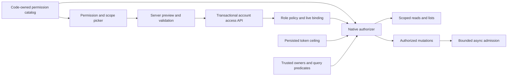

# Granular service-account access

**Spec 009 · End-state product proposal and source-based feasibility assessment · 16 November 2026**

## 1. Outcome and relationship to earlier work

An org administrator can create a service account, choose exactly what it can do and which resources it can reach, preview the result, and issue a bounded API token. Common tasks use presets; advanced users can select individual operations. The API enforces the same access the UI describes across detail, list, streaming, mutation, and supported background-operation paths.

This builds on [spec 008's native-grants model](../008-customer-rbac-foundation/native-grants-model.md): one format-4 grant shape, live nested operation bundles, explicit resource kinds, `ids: ["*"]` or concrete ID arrays, trusted ownership, additive grants, and independent credential ceilings. That foundation is a proposal, not completed implementation. Its semantics remain unchanged. Delivery now targets the complete customer-facing feature in one coordinated effort: the pure catalog/matcher is the first reviewable engineering milestone, not a separate product launch or stopping point.

Recover the product goals from [spec 006](../006-control-plane-authorization/authorization-model.md), not its discarded all-at-once cutover. The latest choices take precedence: live bundles rather than frozen role lists; scopes inside policies rather than bindings; small reviewable changes with coordinated activation rather than either an unreviewed global switch or serial partial-product releases; and a permission picker with optional individual-operation selection rather than a presets-only UI. Existing users' access remains the migration baseline. Any deliberate narrowing or expansion needs its own reviewed change.

**What “all granular permissions” means:** every supported customer operation has an explicit operation/target/response contract, and customers can compose supported operations without receiving unrelated org-wide authority. It does not mean a permission per database table, unlimited policy expressions, or that every internal protocol endpoint becomes usable with a customer token.

Non-goals: runner-shadow work, runner-attempt credential redesign, staff/platform access redesign, cross-org grants, deny rules, label/regex selectors, customer-authored bundle definitions, reusable custom-role administration, or changing authentication protocols. A dependency that could bypass a released grant must be addressed for that slice; unrelated security findings do not block all progress.

## 2. Customer journeys and concrete grants

| Journey | Grant intent | Required negative control |
| --- | --- | --- |
| Fleet diagnostics bot | Install Reader for all current and future org installs | Cannot read app-build logs, app endpoints, org-only operations, or another org |
| Deployment bot | Read installs A/B; deploy components on A/B | Cannot delete installs, approve a restricted plan, change inputs, or deploy C |
| Support exporter | Read logs beneath A/B, without install/job detail endpoints | No org-wide log access or parent-app access; whole-stream contents remain the unit |
| Build bot | Read app/build status and start builds for app A | Cannot deploy installs merely because they use the build |
| Telemetry bot | Read telemetry and ingest it for one install | Cannot reveal collector credentials, issue credentials, or configure a collector |
| Mixed automation | Read every install; cancel jobs for install A only | The write permission cannot combine with the wildcard read scope |
| Org administration automation | Explicit access-administration preset with credential controls | Not a default selection; cannot exceed the issuer's allowed delegation |

Representative account policy; operation IDs beyond spec 008 are proposed catalog additions:

```json
{
  "format": 4,
  "api": "ctl-api",
  "grants": [
    {
      "scope": {"kind": "install", "ids": ["*"]},
      "permissions": ["install.read"]
    },
    {
      "scope": {"kind": "install", "ids": ["install_a", "install_b"]},
      "permissions": ["install.deploy"]
    }
  ]
}
```

This grants reads for future installs but deployment only for A/B. The trusted role/binding supplies the org. Missing/empty IDs, partial globs, wildcard-plus-ID mixtures, and foreign resources never mean “all.” A wildcard selects resources, not operations. Creation is checked against an existing parent, not a fictional future child ID.

## 3. Permission catalog and useful defaults

### A server-owned catalog drives both authoring and enforcement

Each atomic operation has a stable ID, title, description, domain, authorization target kind, supported scope kinds, response/side-effect contract, sensitivity, additional prerequisites, and coverage status. Each bundle has an ID, title, description, explicit members, supported scopes, and a live-expansion notice. Code owns these definitions; the API publishes their authoring metadata and catalog revision.

Separate three concepts: **defined** in the catalog, **enforced** across its supported entry points, and **available to this actor** for assignment. The picker only enables combinations whose enforcement is ready and whose delegation is allowed. This is not a customer-versus-machine permission split. A customer telemetry bot may use ingestion when an eligible path exists; a grant does not bypass audience, cloud proof, current-attempt, or managed-account ownership requirements.

Every supported route/tool maps to a catalog operation or an explicit anonymous/authentication/platform-only contract. The following is the target domain breakdown, not a claim that these names are already implemented or that a route census is complete:

| Domain | Proposed independently grantable operations | Targets and separation |
| --- | --- | --- |
| Org identity/settings | `org.inspect`, `org.settings.update`, `org.feature_flags.update` | Current org; no access administration implied |
| Access administration | `org.members.read`, `org.members.manage`, `service_account.inspect`, `service_account.create`, `service_account.update`, `service_account.delete`, `service_account.access.manage`, `credential.issue`, `credential.revoke` | Org initially; assigning a grant requires delegated authority as well as the management operation |
| Apps and config | `app.inspect`, `app.create`, `app.update`, `app.config.read`, `app.config.sync`, `app.delete` | Create at org; existing apps at app/org; delete/forget distinct from routine edits |
| Branches/components/builds | `app.branch.read`, `app.branch.manage`, `component.inspect`, `component.config.update`, `component_build.inspect`, `component_build.start`, `component_build.cancel` | Verified app ownership; build start does not authorize install deployment |
| Install lifecycle | `install.inspect`, `install.create`, `install.update`, `install.delete` | Create at app; delete/forget/full deprovision remain destructive |
| Install operations | `install.deploy`, `install.inputs.read`, `install.inputs.update`, `install.components.update`, `install.sandbox.run`, `install.drift.read`, `install.drift.resolve` | Existing install; secret input values and raw state have separate contracts |
| Actions/runbooks/workflows | `action_definition.read`, `action_definition.update`, `action.execute`, `workflow.inspect`, `workflow.cancel`, `workflow.retry`, `workflow.approve` | Owning app/install or exact operation where supported; retry/approval also require the underlying operation's authority |
| Jobs/runners/logs | `runner.inspect`, `runner_job.inspect`, `runner_job.cancel`, `log_stream.read`, `log_stream.append` | Existing ownership and named job-log read relation; cancellation and append are not diagnostic reads |
| Telemetry | `telemetry.read`, `telemetry.ingest`, `telemetry.configure`, `telemetry.credentials.issue` | Install/telemetry target with explicit transport prerequisites; ingestion is not configuration |
| Sensitive data | `install.inputs.reveal`, `execution_state.read`, `execution_state.write`, `runner.config.read`, `runner_job.config.read`, `stack.config.read`, `trigger.payload.read` | Separate from ordinary inspection; owner-specific transport/execution requirements still apply |
| Stack reporting | `stack.report`, `phone_home.report` | Exact stack/install/version contract; reporting cannot retrieve configuration or initiate unrelated work |
| Shared integrations/trust | `integration.inspect`, `integration.configure`, `oidc_trust.manage`, `cloud_connection.manage`, `vcs_connection.manage`, `identity_provider.manage` | Org; retain external-control proofs and browser intent requirements |
| Triggers/delivery | `trigger.inspect`, `trigger.configure`, `trigger.credentials.rotate`, `event.submit`, `notification.read`, `notification.configure`, `notification.deliver` | Actual org/app/install owner, verified ingress and approved destinations |
| Notebooks/reports | `notebook.read`, `notebook.execute`, `policy_report.read` | Actual owner and disclosure review; platform-only cases are not exposed as customer grants |

Names must be reconciled with existing IDs before implementation. Preserve old atomic contracts or migrate them explicitly; do not reinterpret persisted `telemetry.write` or `log_stream.write` merely to improve naming. The historical [operation inventory](../006-control-plane-authorization/operation-inventory.md) supplies discovery leads, not a current completeness proof.

### Nine presets remain easy entry points

Offer Reader, Editor, and Admin for org, app, and install. A preset is a UI recipe for native references, not a new policy shape. Supported scope selection includes all resources or selected resources of the preset's kind. Adding a narrow preset never subtracts an existing broad grant.

- Reader uses the corresponding live `.read` bundle, including explicitly listed diagnostic operations within scope.
- Editor uses `.read` plus a new `.edit` bundle of enumerated routine writes. It excludes destructive lifecycle and access-administration operations.
- App/Install Admin adds the corresponding destructive lifecycle operation; it is operational administration, not permission delegation.
- Org Admin explicitly includes access administration and reviewed shared-trust management. Sensitive reads and protocol capabilities are documented individually, never inferred from the word “Admin.”

**Do not use spec 008's `.write` as the Editor bundle.** Its broad compatibility meaning includes destructive operations. Introduce `.edit` alongside it; preserve `.write` for existing holders until a reviewed migration. Likewise, release-safe read bundles require the response-contract work below; renaming current reads does not sanitize their payloads.

Useful narrower presets can be recipes such as Deploy selected installs or Read install logs. They add no new engine semantics. Customer-authored reusable bundles are deferred; the advanced picker composes existing bundles/operations only.

## 4. UI: scopes first, presets first, explicit customization

Extend Settings → Service accounts. Preserve user-managed/system-managed filtering and ownership labels. System-managed identities remain inspectable where allowed, but this editor cannot mutate them. Do not classify permission eligibility from the identity's display name.

### Create and edit

Use the current service-account list scaffold. The access editor is a dedicated detail page or large panel using existing Stratus patterns, not an ever-growing role dropdown. A proposed detail route is `/:orgId/settings/service-accounts/:accountId`, with routed Access and Tokens sections.

1. **Identity:** name and purpose description. No implicit Admin or org-read grant. Creation with an empty grant set may produce an inert account; show “No access” and do not issue a token automatically.
2. **Add access:** choose the scope kind, then “All current and future …” or “Select …”. The latter uses paginated search and explicit selected IDs, not names as authority. A page-level select-all selects only those loaded IDs and is labelled accordingly; it never switches to `[*]`.
3. **Choose permissions:** show compatible presets and live bundles first; “Choose individual permissions” exposes searchable domain groups. Unsupported scope combinations are unavailable with a reason. Changing kind requires reviewing/removing incompatible permissions, never silently broadening them.
4. **Review:** show a server-computed allow summary, excluded families, future-resource/live-bundle notices, overlapping grants, sensitive/destructive warnings, additional protocol requirements, and the exact normalized policy in an expandable JSON view.
5. **Save:** revalidate on the server with optimistic concurrency. On conflict preserve the draft, show what changed, and require review again. Updating permissions does not issue/reveal a token.

Conceptual screen, using the existing list → detail/panel → form pattern rather than new navigation chrome:

```text
Service accounts / deploy-bot                       Access | Tokens

Access rule 1                                      Remove rule
Resource scope      Installs
Resources           All current and future installs in Acme
Permissions         Install Reader                 Live bundle
                    Includes install, job and log reads

Access rule 2                                      Remove rule
Resource scope      Installs
Resources           [install_a] [install_b]         Select installs
Permissions         Deploy components

Add access

Review: Reads every install; deploys only A and B.
Excluded: app endpoints, app-build logs, deletion, input changes.
Existing install responses may include embedded app metadata.
                                                   Review changes
```

### Bundles are not a misleading checkbox tree

A selected live bundle shows included operations as inherited/covered, not independently removable. To remove one member, the user chooses “Convert to explicit permissions,” reviews the current expanded leaf set, then edits it. Save the explicit set, not a hidden bundle-minus-deny rule. Explain that it stops receiving future bundle members; resource wildcards still include future resources.

Overlapping rules remain additive. Removing log read from one rule may leave it allowed through another. The preview identifies the remaining source; never display a narrowed effective result merely because a checkbox became unchecked.

### Token creation is a separate step

After saving account access, offer “Create token.” Choose a name, expiry, and a ceiling no broader than the account's and issuer's permitted authority. Default the draft ceiling to the currently selected account grant references; make narrower choices available through the same editor. Show the secret once, outside analytics, URLs, logs, and persistent browser storage. Inventory never returns the secret.

Display both “Account access” and “Token limit,” with effective access as their intersection. An older token does not acquire a newly added account grant outside its stored ceiling. Live bundle expansion and wildcard resource growth still apply as specified by 008, and the UI says so. Removing an account grant narrows its tokens; restoring it may restore access within an unrevoked token's ceiling. Use revocation when restoration must be impossible.

States required before release: empty/no-access, loading, unavailable catalog, partial resource-search failure, zero matching resources under a wildcard, deleted selected resource, unsupported historical grant, managed account, read-only administrator session, token expired/revoked, conflicting edit, sensitive-permission review, and successful one-time secret display. Keyboard users must be able to add/remove rules, select resources, inspect bundle members, and reach all error messages.

Implementation reuses `ListPage`, `DetailPage`/routed `TabNav` or `Panel`, `Table`, `FormSelect`, `FormCheckbox`, `FormInput`, `FormErrorBanner`, `Expand`, `Code`/`JSONViewer`, and `Toast`. Follow TanStack Form's flat-field restriction: edit one flat rule draft at a time, then serialize the validated grant list; do not bind nested policy JSON directly to form fields. No production UI is implemented by this spec.

## 5. API and storage contracts

Proposed additions extend existing account/token services; endpoint names are design contracts, not registered routes:

| Surface | Contract |
| --- | --- |
| `GET /v1/permissions/catalog` | Revision, operations, bundles, presets, supported scopes, sensitivity, enforcement availability, prerequisites; actor-specific assignment availability is clearly distinguished from definitions |
| `GET /v1/service-accounts/{id}/access` | Owned format-4 policy, opaque ETag, other effective grant sources with provenance, and management eligibility; no lossy legacy response map as authority |
| `POST /v1/service-accounts/access-preview` | Draft policy plus optional account ID and expected catalog revision; returns normalized policy, current effective summary/delta, warnings and errors without mutation; permission-gated to avoid an existence oracle |
| `PUT /v1/service-accounts/{id}/access` | Replace only this account's owned access policy, require `If-Match`, perform live authorization and validation atomically; stale ETag returns conflict/precondition failure |
| Existing `POST /v1/service-accounts` | Add an explicit policy input for native clients; legacy `role` and native policy are mutually exclusive. Create identity, private role, policy, and binding atomically |
| Existing `POST /v1/tokens` | Add an explicit native ceiling; persist it with expiry, actual issuer and subject, and existing source lineage; one-time secret response |
| Existing token inventory/revocation | Return ceiling and effective-access summary without secret; retain account when revoking a token; implement explicit atomic rotation rather than relying on invalidate-then-create |

Reuse existing resource-list endpoints for scoped search once their filtering contracts are proven. Where only selection labels are needed, return minimal IDs/names under explicit discovery authorization, not full app responses. Avoid a second generic resource-query engine.

Keep Account → AccountRole → Role → Policy. Initially store one private, customer-owned role/policy per service account and org, containing multiple grant entries. No customer-wide shared custom role definitions. Protect mutation by checking the binding's ownership/exclusivity and locking the account/role, not by trusting a supplied role ID. Presets become policy references; standard shared roles are never edited through this API.

The ETag covers canonical owned policy and relevant binding state. Re-read/check it under the mutation lock; catalog revision is checked separately so a catalog rollout cannot invalidate the review unnoticed. A schema revision column is optional if a content-derived ETag and existing locking suffice. The existing `Role.Version` is not a concurrency token.

Existing broad/shared bindings must be visible in the preview. The owned-policy editor cannot silently remove or overwrite them. Moving an existing account to fully managed native access requires an explicit before/after conversion that handles those bindings; an empty owned policy does not mean “No effective access” while other sources remain.

**Schema work is real:** the current JSONB policy column can hold native grants, but current Token has no granular ceiling. Add a versioned ceiling document to existing token storage and thread it through authentication and issuance. Durable access-change history also needs an identified persistence owner; logs alone are not a user-auditable history. No new authorization service or graph database is needed.

Illustrative interface change, not a migration instruction:

```diff
- create service account: { name, role }
- replace all org roles with one role type
+ create service account: { name, policy: { format: 4, grants: [...] } }
+ edit the owned policy with If-Match; preserve unrelated grant sources
- create token: { account_id, duration, invalidate }
+ create token: { account_id, duration, ceiling: { format: 4, grants: [...] } }
```

## 6. Delegation, ceilings, and authority-changing actions

Keep org-admin-only management eligibility for the initial release. Fine-grained access-administration operations are an end-state catalog goal, not a prerequisite to release install read/deploy selection. Scoped App/Install Admin does not acquire access delegation.

Assignment requires both management authority and authority to delegate the requested operations/scopes. Issuance additionally requires the requested ceiling to fit the live subject grants and the caller's current credential restrictions. A preview is explanatory, not an authorization ticket; save/issue recheck under coordinated locks. Audit the actual human/service actor separately from the target account.

Containment must cover future resources: an explicit list of all current installs does not authorize issuing `ids: ["*"]`. Use catalog-defined scope relationships and native semantic containment, not today's resource enumeration or string-prefix matching. For live bundles, require a covering live bundle relationship for delegating that evolving capability; a coincidentally equal list of current leaf operations is insufficient. Difficult cross-kind/related-stream containment may be conservatively rejected with a clear reason until proven; runtime permission intersection still uses operation/resource pairs, not matching provenance paths.

The service account is an independent principal, not permanently tied to its creator's membership. Issuer attribution and issuance-time checks remain, but creator departure does not implicitly delete the account. Credential source-chain revocation continues to apply where the issuance contract creates such a chain. Removing account authority or revoking a token restricts future requests; do not promise synchronous cancellation of already accepted cloud operations.

## 7. Enforcement and response contracts make the picker truthful

The public org middleware must separate tenant resolution from broad operation authorization for migrated routes. A restricted install bot cannot require `org.read` merely to pass middleware. Each migrated route then has an explicit atomic operation, canonical target resolver, required related-target checks, and compatible response shape. Keep unmigrated routes on their established checks; no global fallback OR between old and new evaluators.

Lists, counts, searches, facets, SSE, downloads, and bulk APIs must use the same target set as point authorization. Apply scope predicates before pagination; retain install ancestry for wildcard install logs. Shared-stream relations use distinct-resource semantics. Client-side hiding and filtering a fetched page are not enforcement.

The foundation intentionally preserves today's embedded response data. The final UI must distinguish endpoint access from field isolation. Before offering a narrower read contract, classify fields and either keep explicitly documented embedded data or add a versioned/minimal representation with client migration. Raw state, secret inputs, credentials, and execution configuration need explicit operations; do not silently narrow an existing atomic contract. Logs remain whole-stream producer content that may contain secrets—do not label them universally sanitized. Parent-stream ingestion fan-out remains a disclosed side effect.

For mutations, separate routine edits, deployment, approval, cancellation, retry, and destructive lifecycle work. Authorize referenced objects and every affected target. A generic retry/approve permission cannot restart a delete operation without delete authority. Install creation and app deletion cascades need parent/all-target checks rather than inferred HTTP verbs.

For asynchronous operations exposed through granular grants, persist enough accepted authority to bind the initiating subject, permitted operations, targets/config, ceiling, and approval context. Future dispatch/retry checks cannot reconstruct authority from `CreatedByID` alone. Stage this per workflow family: a deploy checkbox is not released until its normal, retry, approval-release, and bulk paths satisfy its contract. This is a customer-operation dependency, not authorization to restart all runner credential work. The exact in-flight revocation boundary needs a separate workflow design and live proof before claiming it in UI copy.

REST is the initial service-account transport; CLI/SDK clients use the same APIs. Existing MCP static-token/service-account exclusions remain unless explicitly changed in a separate decision. Similar permission names do not change transport eligibility. Federation and managed protocol entry points share semantics only after their own issuance/admission integration is ready.



## 8. Feasibility: buildable, but not a UI-only feature

Assessment baseline: local `main` at `99502d414be64e324249716257faf8ab9d683f44`, with the earlier uncommitted grant-preservation change. Evidence below is current source inspection, not proof of deployed behavior. Historical spec-006 progress claims are not used as evidence that its code shipped.

| Finding and evidence | Consequence | Assessment |
| --- | --- | --- |
| [Policy JSONB and hooks](../../services/ctl-api/internal/app/policy.go) exist, but decode v3 and require `LegacySources`; [Role compilation](../../services/ctl-api/internal/app/role.go) also requires projection | 008 must remove validation's dependency on legacy representability before any arbitrary native policy can load | Feasible prerequisite, not complete |
| [Scope](../../services/ctl-api/internal/pkg/authz/permissions/scope.go) stores one ID and rejects `*`; [catalog](../../services/ctl-api/internal/pkg/authz/permissions/catalog.go) has limited bundle expansion | Multi-ID/wildcard scopes and live transitive bundles are actual engine work, not JSON-only edits | Bounded foundation work |
| [Service-account API](../../services/ctl-api/internal/app/accounts/service/service_account.go) accepts `{name, role}`; [SetAccountOrgRole](../../services/ctl-api/internal/pkg/authz/set_account_role.go) deletes all org bindings before adding one | Do not reuse the current role replacement for a multi-grant editor; add owned-policy updates and explicit conversion | Feasible with transactional API changes |
| [Policy](../../services/ctl-api/internal/app/policy.go) is unique per role; [AccountRole](../../services/ctl-api/internal/app/account_role.go) supports multiple bindings | One private policy containing many grants fits; parameterized shared custom roles are unnecessary | Existing storage is sufficient for account grants |
| [Token](../../services/ctl-api/internal/app/token.go) has expiry and source lineage but no ceiling; [CreateTokenRequest](../../services/ctl-api/internal/app/tokens/service/token.go) has no policy | Persisted credential restrictions need schema, issuer, loader, inventory and client changes | Material backend dependency |
| [Service-account token helper](../../services/ctl-api/internal/app/accounts/helpers/service_account_token.go) invalidates before separate creation | The current checkbox is not atomic rotation; prove replacement/revocation under failure and concurrency | Lifecycle work, not UI polish |
| [Org middleware](../../services/ctl-api/internal/middlewares/org/org.go) performs org CRUD checks before handlers; [require](../../services/ctl-api/internal/pkg/authz/require/require.go) still uses object/CRUD decisions | Scoped accounts can be blocked before a correct leaf check; migrated routes need tenant-only resolution plus complete explicit authorization | Largest cross-cutting integration dependency |
| [Job list](../../services/ctl-api/internal/app/runners/service/get_runner_jobs_ctl_api.go) filters org/runner then paginates; [install read](../../services/ctl-api/internal/app/installs/service/get_install.go) preloads app, inputs and runner/config data | Need SQL ownership predicates and response classification; narrow metadata checkboxes cannot be inferred from current handlers | Feasible in slices; query cost and disclosure unproven |
| [Create UI](../../services/dashboard-ui/client/components/service-accounts/CreateServiceAccount/CreateServiceAccount.tsx), [role options](../../services/dashboard-ui/client/hooks/use-roles.ts), [list](../../services/dashboard-ui/client/views/org/ServiceAccounts.tsx) and [token UI](../../services/dashboard-ui/client/components/service-accounts/ServiceAccountToken/ServiceAccountTokenContainer.tsx) exist | Reuse scaffolds, forms, API layer and one-time token display; replace one-role assumptions with server-described grant rules | Lower risk once API contracts exist |
| [Change-role container](../../services/dashboard-ui/client/components/service-accounts/ChangeServiceAccountRole/ChangeServiceAccountRoleContainer.tsx) selects `roles[0]` | Existing edit UI cannot represent additive grant sources; do not silently round-trip through it | Must retire or restrict for native accounts |
| [MCP eligibility](../../services/ctl-api/internal/app/mcp/server/auth.go) rejects static tokens and non-human accounts | Do not advertise service-account MCP access as a consequence of this feature | Explicitly outside initial transport scope |

**No architectural blocker found:** the existing Go/PostgreSQL/React structure can host this model without an external policy engine. The dominant work is operation/route coverage, filtered queries, response boundaries, credential restrictions, and background effects—not selecting checkboxes. A full delivery estimate is not credible until the first vertical slice measures those costs.

Checks performed for this assessment: inspected the files above and the original product thread, compared 006's intended behavior with current source, and checked local tooling. Local API schema access returned HTTP 401, so no authenticated live schema or API behavior was verified. The component preview on port 61000 was reachable. No production data was queried; no database MCP was available in this session. SQL plans, race behavior, scale limits and real deploy/revoke journeys remain unproven. A rendered HTML spec is a review surface, not an implementation demo.

## 9. Coordinated delivery and activation gates

**One customer-facing delivery goal, three overlapping workstreams.** This replaces the serial F0–F5 release plan. Keep changes small enough to review and integrate continuously; do not wait for each intermediate capability to become a separate product release. Broad implementation is encouraged, while production activation still depends on complete enforcement and compatibility evidence. A partial picker or a catalog that nobody can use is not completion.

### Workstream ownership and dependencies

| Workstream | Scope and owning modules | Starts and hands off |
| --- | --- | --- |
| A — Native authority and policy lifecycle | `pkg/authz/permissions`, `pkg/authz/account_permissions.go`, account/role/policy model loading, constructors/reconciliation, and credential authority loading. Own format-4 documents, catalog, compilation, matching, ceiling evaluation, and removal of projection dependencies | Starts first with shared contracts. Supplies stable interfaces to B/C; owns catalog and common authorizer changes so domain work does not fork the model |
| B — Broad operation coverage | Org middleware, `pkg/authz/require`, domain services/helpers and relevant workflows. Own operation/target mapping, canonical ownership, SQL filters, response contracts, multi-target mutations and continuation checks across all customer families | Inventory starts immediately. Domain implementation overlaps A/C after interface agreement; real install/job/log integration validates shared assumptions before broad activation |
| C — Usable service-account product | Account/token services, token storage/issuance, catalog/preview/owned-policy APIs, durable access history, SDK/CLI consumers, and dashboard service-account components | DTO and UI-state design starts immediately; production behavior uses A's native interfaces. API and UI integrate incrementally rather than waiting for B to finish every domain |

Workstream ownership is responsibility, not three required agents or three separate branches. Assign one implementation owner to each shared file before parallel edits. In particular, A owns token authorization loading while C owns persistence and issuance; their ceiling contract is agreed before either writes a competing representation. Domain additions enter A's shared catalog, not per-domain registries. UI fixtures may unblock form development but do not count as end-to-end evidence.

Before work fans out, settle the codec and scope validation, operation/target resolver interface, collection-filter contract, catalog revision semantics, owned-policy DTO/ETag, ceiling serialization and historical-token behavior. Preserve existing credential restrictions until their migration is explicitly verified. This is a short integration contract, not a second policy-design exercise.

### Milestones are integration checkpoints, not serial launches

| Milestone | Combined deliverable | Evidence and parallel work |
| --- | --- | --- |
| M0 — Contracts and baseline | Shared interfaces; independently reviewable catalog/matcher; current route/writer/cohort inventory begun | Native model examples and negative controls hold; existing decisions unchanged. B inventories domains while C prepares API/UI contracts |
| M1 — First real journey | Native loading, owned policy, bounded token, install/job/log detail and collections, and a thin UI/API create→use→narrow→revoke path | Disposable PostgreSQL plus real auth middleware establishes point/list/count agreement, cross-org denial, wildcard future-resource behavior and ceiling enforcement. Other domains continue implementation; this is not a read-only launch prerequisite |
| M2 — Broad integrated feature | All supported customer families from section 3, Reader/Editor/Admin recipes, full permission picker, token lifecycle, access history and SDK/CLI behavior | Per-family evidence includes alternate entry points, disclosure, bulk/async effects and permission-management containment. Org-admin-only management stays an activation constraint until any broader delegation is proven, not a substitute for that proof |
| M3 — Upgrade and release candidate | Existing-account conversions, all policy writers/reconciliation, compatibility retirement, mixed-version reader ordering and rollback rehearsal | Production-shaped disposable data, both role orders, historical credentials and supported upgrades preserve baseline decisions or identify explicitly approved changes; the seven journeys work through actual APIs/UI |
| M4 — Controlled activation and closure | Reader-capable deployment followed by authorized native writes, policy conversion and customer feature activation | Verify the candidate with a bounded rollout before broad enablement; complete the coverage ledger and remove obsolete runtime paths. Remaining explicit exceptions are reported as unfinished scope, not silently declared complete |

Use two apps, three installs, an app build, install jobs, shared streams, and an org-owned stream for M1. Exercise wildcard and selected-ID reads through real middleware, list/count/pagination, downloads/SSE, and native-ceiling tokens. Measure query plans and latency against baseline; include an empty org and an install created after issuance. Correct shared-model failures before propagating them, but continue independent catalog inventory, API/UI work, and domain implementations. No calendar estimate is asserted before this evidence exists.

### Coverage and compatibility have explicit completion criteria

Maintain one delivery ledger in this spec directory during implementation, with one row per operation family and linked entry points. Record the responsible implementation owner, operation IDs, point resolver, collection predicate, response sensitivity, mutation/continuation contract, catalog availability, decision authority during rollout, and verification evidence. Cover every registered customer entry point and callable alternate path; record anonymous/authentication/platform-only exclusions explicitly. Retain existing MCP and protocol eligibility—the ledger is not authorization to open new transports.

For each temporary compatibility path, add its actual policy cohorts and callers, why it remains, and the evidence needed for removal. The v3 migration is a useful baseline, not proof that every current row or writer is convertible. Start conversion analysis early; verify mixed roles, skipped historical policies and managed reconciliation instead of building more legacy adapters around them.

A path can retire when its callers/writers no longer require it, affected current data has a verified conversion or explicit disposition, decision/response parity is demonstrated or differences approved, and supported upgrade plus reader-capable rollback checks pass. The complete customer feature must not depend on unfinished legacy projection. Historical migration utilities can remain for supported upgrades without remaining request-time authorization paths. Do not make readers accept guessed reverse conversions merely to permit an old-binary rollback.

### Separate landing code from exposing authority

Use the existing feature/rollout mechanisms only for the activation boundaries needed here; do not add a permanent flag per permission. Reader/catalog support must reach all API and worker instances that load the new documents before writers are enabled. An old client must not overwrite native policies through singular-role replacement; conversion and native editing use the explicit contracts in section 5.

Every route/cohort has one documented authority path during transition. Existing access remains on its verified baseline until converted; a new native principal must not fall through an unmigrated broad check. No “old OR new” fallback. A catalog entry or hidden UI control alone is not enforcement. A capability becomes customer-assignable only when all its detail/list/count/stream/download/bulk and relevant continuation paths obey the declared scope. Deployment, migration, and shared-data writes still require their own approval.

Stop activation of an affected capability if ownership requires guesses, scoped queries cannot be bounded/indexed, a response cannot meet its disclosure contract without client migration, or an alternate mutation path exceeds the grant. Fix the dependency or explicitly revise the release scope; do not silently broaden access, hide the gap behind a disabled checkbox and call the end state complete, or pause unrelated workstreams for unrelated security findings.

## 10. Audit, observability, and release acceptance

| Event/metric | Required fields or labels | Purpose |
| --- | --- | --- |
| Access policy changed | Actual actor, credential ID (never secret), subject, org, old/new policy revision, catalog revision, added/removed references and scopes | Durable admin history and incident attribution |
| Credential issued/rotated/revoked | Actor, subject, token ID, source reference, expiry, ceiling revision, outcome | Verify lifecycle without leaking bearer material |
| Authorization decision | Operation ID, scope kind, surface, allow/deny reason, catalog revision; detailed resource IDs only in controlled audit records | Diagnose missing coverage and denied automation |
| Authorization latency | Operation family, resolver/query stage; bounded labels | Detect expensive ownership/predicate paths |
| Picker preview/save | Success/conflict/validation category and catalog revision; no secret, policy payload, raw resource names or token value in analytics | Detect misleading options and failed authoring |

Use existing observability conventions. Choose a durable access-history store during API implementation; this assessment did not establish one suitable for policy diffs. Resource/account IDs must not be high-cardinality metric labels. Permission evaluation logs must not expose protected payloads.

Final acceptance requires the seven customer journeys above, every offered preset/scope pair, mixed grants, wildcard-versus-explicit ceilings, unsupported/foreign/deleted IDs, overlapping grant sources, concurrent edits/issuance, managed-account refusal, token rotation failure, one-time secret handling, and transport eligibility. Check detail/list/count/SSE/download agreement, destructive cascades and background retries through real entry points. Inventory all registered customer routes and alternate helpers; tests for a few handlers do not establish “all granular permissions.”

Maintain the baseline for existing customers during migration. New restricted personas use this spec's explicit contract. Catalog expansion, response narrowing, new transport eligibility, and changed accepted-work revocation are separately visible behavior changes. The spec does not authorize implementation, production migration, deployment, or renewed monitoring.

## 11. Review choices and implementation handoff

Proposed defaults worth reviewing: presets plus advanced atomic selection; live-bundle conversion to explicit leaves rather than deny rules; one private policy per account/org; org-admin-only management initially; persisted live-reference token ceilings; and existing embedded data documented until deliberate response migration. No expiry maximum, query-performance threshold, or in-flight revocation promise is invented here; settle those from existing policy and the first live slice before release.

Implementation starts with the M0 shared contracts and reviewable foundation change, then continues across all three workstreams in section 9 without waiting for separate partial-product launches. Keep work in the existing authz/account/token/domain owners and dashboard service-account components. The first integrated target is M1; it validates the shared approach, while M2–M4 remain part of the same delivery commitment. The HTML companion supports line-by-line review; comments are local Markdown downloads, not server-side submissions.
